# 第一章 大型语言模型 LLM 介绍

> **代表型号更新至 2026 年 11 月。** 型号和 API 更新很快，实际接入前仍应查看厂商的 Models 与定价页。

## 1.1 大型语言模型（LLM）简介

**大语言模型（LLM，Large Language Model）是能够理解和生成自然语言的神经网络模型。**

大语言模型通常在大量文本上训练。本章依次介绍国外的 GPT、Claude、Gemini、Llama 与 Muse、Grok，以及国内的深度求索 DeepSeek、通义千问 Qwen、月之暗面 Kimi、智谱 GLM、豆包 Seed、腾讯混元 Hy、小米 MiMo 和文心 ERNIE。

为了探索性能的极限，许多研究人员开始训练越来越庞大的语言模型，例如拥有 `175B (1750 亿)`参数的 `GPT-3` 和 `540B（5400 亿）`参数的 `PaLM` 。尽管这些大型语言模型与小型语言模型（例如 `3.3 亿`参数的 `BERT` 和 `15 亿`参数的 `GPT-2`）使用相似的架构和预训练任务，但它们展现出截然不同的能力，尤其在解决复杂任务时表现出了惊人的潜力，这被称为“**涌现能力**”。以 GPT-3 和 GPT-2 为例，GPT-3 可以通过学习上下文来解决少样本任务，而 GPT-2 在这方面表现较差。因此，科研界给这些庞大的语言模型起了个名字，称之为“大语言模型（LLM）”。LLM 的一个杰出应用就是 **ChatGPT** ，它是 GPT 系列 LLM 用于与人类对话式应用的大胆尝试，展现出了非常流畅和自然的表现。

语言建模的研究可以追溯到`20 世纪 90 年代`，当时的研究主要集中在采用**统计学习方法**来预测词汇，通过分析前面的词汇来预测下一个词汇。但在理解复杂语言规则方面存在一定局限性。

随后，研究人员不断尝试改进，`2003 年`深度学习先驱 **Bengio** 在他的经典论文 `《A Neural Probabilistic Language Model》`中，首次将深度学习的思想融入到语言模型中。强大的**神经网络模型**，相当于为计算机提供了强大的"大脑"来理解语言，让模型可以更好地捕捉和理解语言中的复杂关系。

`2018 年`左右，**Transformer 架构的神经网络模型**开始崭露头角。通过大量文本数据训练这些模型，使它们能够通过阅读大量文本来深入理解语言规则和模式，就像让计算机阅读整个互联网一样，对语言有了更深刻的理解，极大地提升了模型在各种自然语言处理任务上的表现。

与此同时，研究人员发现，随着**语言模型规模的扩大（增加模型大小或使用更多数据）**，模型展现出了一些惊人的能力，在各种任务中的表现均显著提升（Scaling Law）。这一发现标志着大型语言模型（LLM）时代的开启。

通常大模型由预训练、后训练和在线推理三个阶段构成。预训练 Scaling Law 长期是模型扩展的主线。OpenAI 在 o1 中进一步展示：模型表现会随强化学习训练计算量和测试时思考计算量增加而提升，因此 RL Scaling 和 **Test-time Scaling（测试时扩展）** 开始受到广泛关注。

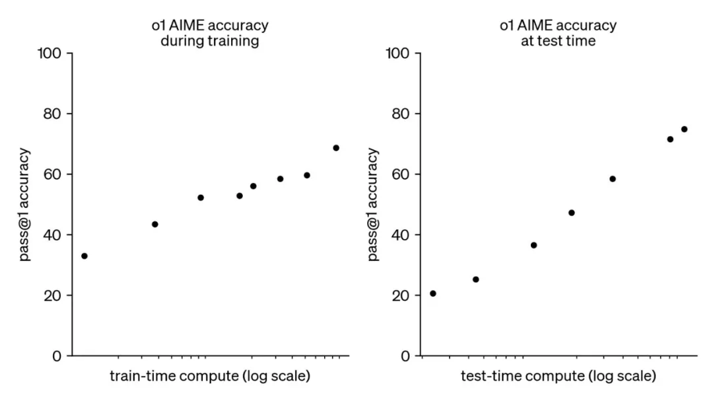

### 1.1.1 常见的 LLM 模型

大语言模型的发展速度相当惊人，国内外有超过百种大模型相继发布。下图按照时间线给出了 2018 年以来部分有影响力的大语言模型：
<div align=center>
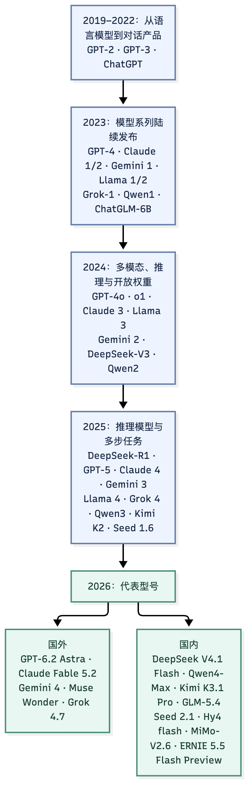
</div>

接下来我们主要介绍几个国内外常见的大模型（包括开源和闭源）。

#### GPT（OpenAI，闭源）

[GPT](https://developers.openai.com/api/docs/models) 是 OpenAI 的闭源模型系列，也是 ChatGPT 背后的模型，主要通过 ChatGPT 和 OpenAI API 提供。

2022 年 11 月，OpenAI 基于 GPT-3.5 推出对话产品 ChatGPT。对话体验相当惊艳，很快让大模型进入普通用户视野。[ChatGPT 上线](https://arstechnica.com/information-technology/2023/02/chatgpt-sets-record-for-fastest-growing-user-base-in-history-report-says/) 5 天用户破百万；两个月后月活约 1 亿，成为当时史上用户增长最快的消费级应用程序。目前其全球月活跃用户已超过 10 亿。

**版本演进**

- **GPT-3 系列（2020—2022）** 把 decoder-only Transformer 扩展到 1750 亿参数，并让 **In-context Learning（上下文学习）** 进入主流视野。只给任务说明或少量示例，模型就能在上下文中模仿新任务，不必更新参数。GPT-3.5 随后沿用 InstructGPT 的 **[RLHF](https://openai.com/index/instruction-following/)（Reinforcement Learning from Human Feedback，人类反馈强化学习）** 路线：先用人工示范做监督微调，再根据人类对回答的排序训练奖励模型，最后用强化学习调整模型。GPT-3.5 和 ChatGPT 把这套后训练方法带入了大规模消费产品，模型也从偏向续写转向按要求完成任务。
- **[GPT-4](https://openai.com/index/gpt-4/) 与 [GPT-4o](https://openai.com/index/hello-gpt-4o/)（2023—2024）** GPT-4 将图像输入带入 GPT 主线，并改进复杂指令、代码和推理能力。2023 年，GPT-4 和 GPT-3.5 Turbo 的 API 加入[函数调用](https://openai.com/index/function-calling-and-other-api-updates/)。早期语音对话要先把声音转成文字，等模型生成文字回答，再把回答转成语音。GPT-4o 用同一个模型处理文字、图像和声音。语音回复更快，模型也能利用语气、停顿和背景声。
- **o1（2024）** 把 **[Test-time Scaling](https://openai.com/index/learning-to-reason-with-llms/)（测试时扩展，也称推理时扩展）** 带入主流模型产品。它先用大规模强化学习训练模型形成内部推理过程，再让模型在回答难题时投入更多计算。OpenAI 的实验显示，o1 的表现会随训练计算量和思考时间增加而提升，说明模型训练结束后，仍可用更多推理时计算换取更好的数学、代码和多步推理能力。
- **[GPT-5 系列](https://openai.com/index/introducing-gpt-5/)（2025—2026）** 把快速回答、深度推理和实时路由合成统一系统：简单问题直接回答，复杂问题再投入更多推理。GPT-5.6 加入[程序化工具调用](https://developers.openai.com/api/docs/guides/tools-programmatic-tool-calling)。例如，模型可以写一段程序去查询多份资料，只把筛选后的结果送回模型。程序由 OpenAI 运行，开发者自定义的函数仍由应用执行。
- **[GPT-6 系列](https://developers.openai.com/api/docs/guides/latest-model)（2026）** 在 [Epoch AI 的评测](https://arxiv.org/html/2609.25050)中，GPT-6 Astra 解决了 68 道当时尚无已知解答的埃尔德什猜想中的两道。它证明了一道，并找出反例推翻了另一道。两项结果都通过了数学证明工具 Lean 的检查。[GPT-6.2 Astra](https://deploymentsafety.openai.com/gpt-6-2-astra-sol/ai-self-improvement-capabilities) 进一步提升排查模型训练故障。研究人员给它失败实验的代码和日志，他能找出故障原因并提出修复办法。

**当前型号**

| 型号 | 上下文长度 | 知识截止日期 | 主要用途 |
| --- | ---: | --- | --- |
| GPT-6 Luna | 1.05M | 2026-05-18 | 成本敏感的批量处理和高吞吐调用 |
| GPT-6.1 Terra | 1.05M | 2026-06-01 | 视觉推理、计算机操作和写作 |
| GPT-6.2 Sol | 1.05M | 2026-06-01 | 兼顾质量与成本的复杂任务 |
| GPT-6.2 Astra | 1.05M | 2026-05-18 | 高难度推理、复杂编码和长工具链 |

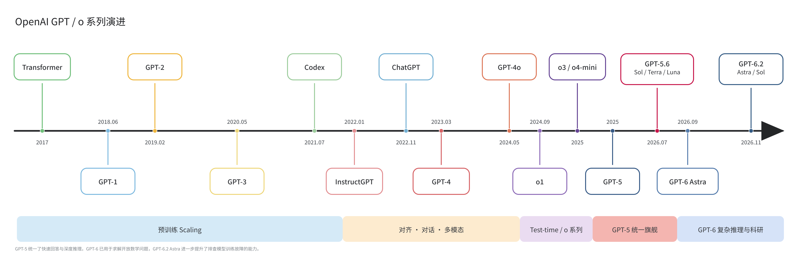

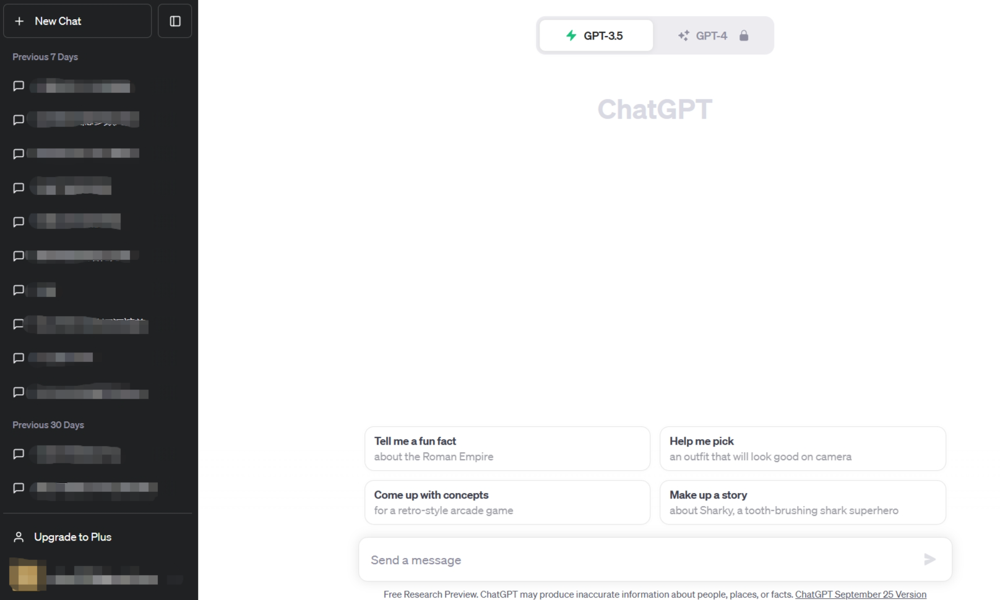

#### Claude（Anthropic，闭源）

[Claude](https://platform.claude.com/docs/en/about-claude/models/overview) 由 Anthropic 开发，长期重视安全训练和长文档处理，近几代又把重点扩展到代码与 Agent。

**版本演进**

- **Claude 1 / 2（2023）** 早期 Claude 采用了 Anthropic 在 [2022 年提出的 Constitutional AI](https://www.anthropic.com/research/constitutional-ai-harmlessness-from-ai-feedback)。模型先按预先写好的原则检查并修改回答。随后由模型比较不同回答，用比较结果训练奖励模型。这一阶段用模型反馈指导强化学习，称为 **RLAIF（Reinforcement Learning from AI Feedback，AI 反馈强化学习）**，可以减少安全训练所需的人工标注。Claude 2 又把上下文扩展到 100K，可以处理更长的文档。
- **Claude 3 系列（2024—2025）** 加入图像理解，并形成 Haiku、Sonnet、Opus 三档。Claude 3.5 Sonnet 随后加入 **[Computer Use](https://www.anthropic.com/news/3-5-models-and-computer-use)（计算机操作）**：模型读取屏幕截图，给出移动鼠标、点击和输入文字等指令。应用执行这些指令，可以操作没有专用 API 的图形界面。[**Claude 3.7 Sonnet**](https://www.anthropic.com/news/claude-3-7-sonnet) 加入 **Hybrid Reasoning（混合推理）**。开发者可以让同一个模型直接回答，也可以启用[扩展思考](https://www.anthropic.com/news/visible-extended-thinking)并设置**思考预算**，限制推理使用的 token 数。
- **[Claude 4 系列](https://www.anthropic.com/news/claude-4)（2025—2026）** 将工具调用接入扩展思考，模型可以在推理中并行调用工具，读取结果后接着推理。Opus 4.6 加入 **[Adaptive Thinking](https://platform.claude.com/docs/en/build-with-claude/adaptive-thinking)（自适应思考）**，模型根据任务难度和 `effort` 设置决定是否展开推理、推理多久。
- **Claude 5 / 5.5 系列（2026）** 沿用自适应思考和 1M 上下文。Opus 5 的 API 提供测试功能：对话中途增删工具时，可以复用缓存的提示词，省去重复处理。
- **Claude Fable 5 / 5.2（2026）** Anthropic 在 6 月推出 [Fable 5](https://www.anthropic.com/news/claude-fable-5-mythos-5)，11 月发布 Fable 5.2。在 [Anthropic 的内部实验](https://www.anthropic.com/claude-fable-and-mythos-5-2)中，Fable 5.2 从空目录开始，协调多个子 Agent 编写、测试和审查代码。八天后，带内核和硬件驱动的操作系统原型能在笔记本电脑上启动。Anthropic 还在[官方推送](https://x.com/claudeai/status/2119899459761131615)中展示了同一模型设计的三件电子设备。模型完成了选件、电路板布线和软件编写，合作方负责制造和组装。三件设备都能运行，电路无需修改。

**当前型号**

| 型号 | 上下文长度 | 知识截止日期 | 主要用途 |
| --- | ---: | --- | --- |
| [Claude Haiku 5.5](https://platform.claude.com/docs/en/models/haiku-5-5/overview) | 1M | 2026-06 | 分类、抽取、路由和高并发调用 |
| [Claude Sonnet 5.5](https://www.anthropic.com/claude-sonnet-5-5) | 1M | 2026-06 | 日常开发、文档和一般 Agent 任务 |
| [Claude Opus 5.5](https://www.anthropic.com/claude-opus-5-5) | 1M | 2026-06 | 长时程编码和复杂知识工作 |
| Claude Fable 5.2 | 1M | 2026-06 | 高难度推理和长时程 Agent |
| [Claude Mythos 5.2](https://platform.claude.com/docs/en/models/mythos-5-2/overview)（需机构审核） | 1M | 2026-06 | 与 Fable 5.2 共用底层模型，面向防御性网络安全和生命科学研究 |

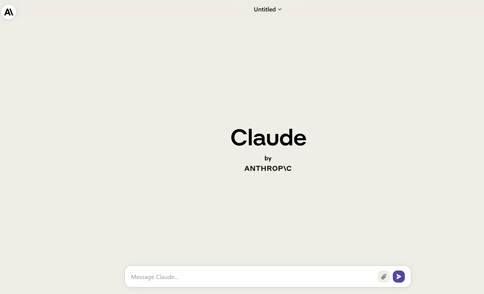

#### Gemini（Google DeepMind，闭源）

[Gemini](https://aistudio.google.com/docs/models) 是 Google DeepMind 的模型系列，原生多模态和长上下文是它较早形成的特点。它通过 Gemini API 和 Vertex AI 提供，并与 Google Search 等服务集成。

**版本演进**

- **[Gemini 1 系列](https://deepmind.google/gemini/gemini_1_report.pdf)（2023—2024）** 继 PaLM 之后发布，在训练时一同使用文本、图像、音频和视频，这称为原生多模态训练。**[Gemini 1.5](https://blog.google/innovation-and-ai/products/google-gemini-next-generation-model-february-2024/)** 采用稀疏 **MoE（Mixture of Experts，混合专家）**。[Shazeer 等人早在 2017 年](https://arxiv.org/abs/1701.06538)就把稀疏 MoE 用于语言建模。模型将每个 token 交给少数专家网络处理，可以在控制计算量的同时扩大模型容量。Gemini 1.5 也把上下文扩展到百万 token。
- **[Gemini 2 系列](https://blog.google/innovation-and-ai/models-and-research/google-deepmind/google-gemini-ai-update-december-2024/)（2024—2025）** 加入图像和音频输出，并推出 Multimodal Live API。模型可以持续接收音频和视频流、实时返回语音，还能在一次交互中组合 Google Search、代码执行和用户自定义函数。**Gemini 2.5** 将推理纳入主力模型，API 支持设置思考预算。
- **[Gemini 3.x](https://ai.google.dev/gemini-api/docs/gemini-3)（2025—2026）** 将精确的 token 预算改为 low、medium、high 等 **[Thinking Level（思考等级）](https://ai.google.dev/gemini-api/docs/generate-content/thinking)**，由模型在每个等级内自行分配推理计算。
- **Gemini 4 系列（2026）** [Argon](https://deepmind.google/models/model-cards/gemini-4-argon/) 延续稀疏 MoE 和原生多模态路线。[Carbon](https://deepmind.google/models/model-cards/gemini-4-carbon/) 基于 [Argon](https://aistudio.google.com/docs/models/gemini-4-argon)，为需要反复检查假设和结果的难题投入更多推理计算。[Hydrogen](https://blog.google/innovation-and-ai/models-and-research/gemini-models/introducing-gemini-4-hydrogen/) 接续 [Gemini 3.8 Flash](https://aistudio.google.com/docs/models/gemini-3.8-flash) 的快速型号路线。排查代码时，它可以同时请求搜索代码和读取多份文件。搜索没有结果时，它也能根据工具返回的信息调整查询，再继续排查。[Neon](https://deepmind.google/models/model-cards/gemini-4-neon/) 由 [Carbon](https://aistudio.google.com/docs/whats-new-gemini-4-carbon) 改造而来，侧重缩短复杂任务的处理时间和降低费用。

**当前型号**

| 型号 | 上下文长度 | 知识截止日期 | 主要用途 |
| --- | ---: | --- | --- |
| Gemini 4 Hydrogen | 1M | — | 日常编码和需要快速反馈的工具调用 |
| Gemini 4 Argon | 1M | — | 复杂编码、数学推理，侧重响应速度 |
| Gemini 4 Neon | 1M | — | 跨文件调试和多步分析 |
| Gemini 4 Carbon | 1M | — | 难题推理和需要反复验证的工程任务 |

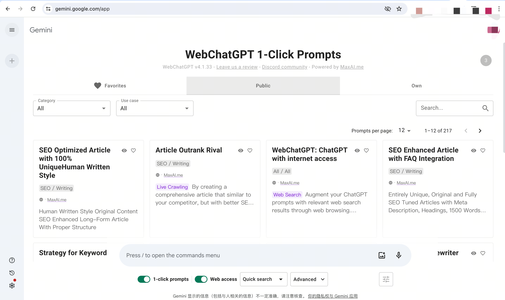

#### Llama 与 Muse（Meta，部分开放权重）

[Llama](https://ai.meta.com/llama/get-started/) 是 Meta 发布的开放权重模型系列，也是 2023 年开源大模型浪潮的重要起点。围绕它形成了成熟的微调、量化和本地推理生态，许多后来的开放模型沿用了这套路径。

**版本演进**

- **[Llama 1 / 2](https://arxiv.org/abs/2302.13971)（2023）** 表明较小的模型只要使用更多数据充分训练，也能取得不错的效果。Llama 2 又增加对话版本并放宽商业使用，随后出现大量微调和量化模型。[Llama 2 70B](https://arxiv.org/abs/2307.09288) 使用了 Ainslie 等人提出的 [**GQA（Grouped Query Attention，分组查询注意力）**](https://arxiv.org/abs/2305.13245)。它让多个查询头共享键和值，减少生成时需要保存的 **KV Cache（键值缓存）**。
- **[Llama 3 系列](https://ai.meta.com/blog/meta-llama-3/)（2024）** 更换为 128K 词表的 tokenizer，同一段文本通常能用更少 token 表示。8B 和 70B 均采用 GQA。**Llama 3.1** 随后发布 405B 模型，并把多语言和长上下文纳入主线。405B 既可直接使用，也能作为较小模型的蒸馏教师。**Llama 3.2（2024）** 的 [11B 和 90B 视觉型号](https://ai.meta.com/blog/llama-3-2-connect-2024-vision-edge-mobile-devices/)已经可以理解图片和图表。
- **[Llama 4 Scout](https://ai.meta.com/blog/llama-4-multimodal-intelligence/) / Maverick（2025）** 则把来自文本和图像的 token 交给同一个主网络一起训练，Meta 称这种做法为 **Early Fusion（早期融合）**。Llama 4 同时改用 MoE，并扩展了上下文长度。
- **Muse Spark（2026 年 4 月）** 是 [Muse](https://ai.meta.com/resources/models-and-libraries/llama-downloads) 系列的[首款模型](https://ai.meta.com/blog/introducing-muse-spark-msl/)。它能根据图像中的信息推理，也支持工具调用。10 月发布的 [Muse Spark Open](https://dev.meta.ai/docs/muse-spark-open) 开放了权重，可以接收文本、图像、音频和视频并输出文本。
- **Muse Wonder（2026 年 10 月）** 延续 Spark 的训练路线，并用多种需要持续处理的任务来训练。以修改现有代码为例，模型要跟踪最初的要求，提出跨文件的修改，再根据测试结果调整方案。11 月，Meta 开始在 Muse 和 Meta AI 中使用 [以 Wonder 辅助训练的专用模型](https://research.meta.ai/blog/specialized-models-for-muse-and-metaai)，让助手更善于判断过去的信息是否仍然有用，以及遇到障碍时怎样继续。

**当前型号**

| 型号 | 上下文长度 | 知识截止日期 | 主要用途 |
| --- | ---: | --- | --- |
| Llama 4 Scout（开放权重） | 10M | 2024-08 | 超长文档、私有化部署和资源受限的多模态任务 |
| Llama 4 Maverick（开放权重） | 1M | 2024-08 | 质量优先的通用文本与图像理解 |
| Muse Ember（API） | 1M | — | 大批量文档处理和信息抽取 |
| Muse Spark 1.3（API） | 1M | — | 多模态推理和常规代码任务 |
| Muse Spark Open（开放权重） | 1M | — | 多模态推理和代码任务 |
| Muse Wonder（API 预览） | 1M | — | 需要持续修改和验证的复杂代码任务 |

Meta 的[模型目录](https://dev.meta.ai/docs/models)把 Muse Wonder Full 列为 Muse Code 提供的型号。

#### Grok（xAI，部分开放权重）

[Grok](https://docs.x.ai/developers/models) 由 xAI 开发，可以通过 Web Search 和 X Search 获取实时信息。搜索工具提供外部资料，模型结合这些资料生成回答。[Grok-1](https://github.com/xai-org/grok-1) 发布过权重，后续主力型号通过闭源 API 提供。

**版本演进**

- **Grok-1（2023；2024 年开放权重）** 在 2023 年随 Grok 产品公开，xAI 于次年公布了 314B 基础模型的权重和推理代码。
- **Grok 4 系列（2025—2026，闭源）** [Grok 4](https://x.ai/news/grok-4)于 2025 年发布，支持工具调用和实时搜索。Grok 4.3 将上下文扩展到 1M，并支持调节推理强度。[Grok 4.5](https://x.ai/news/grok-4-5) 由 xAI 与 [Cursor 联合训练](https://cursor.com/grok-4-5)，使用了包含开发者与 Agent 交互的代码数据，并针对多步软件工程任务做了强化学习训练。2026 年 9 月发布的 [Grok 4.7](https://x.ai/news/grok-4-7) 换用了比 4.6 更大的基座模型，也延长了强化学习训练，加入更多需要数小时才能完成的任务。按发布方的测试，4.7 在耗时较长的代码任务中更能持续处理问题、检查自己的改动。它能[接收文本和图像](https://docs.x.ai/developers/grok-4-7)，输出文本。

**当前型号**

| 型号 | 上下文长度 | 知识截止日期 | 主要用途 |
| --- | ---: | --- | --- |
| Grok 4.7（闭源） | 500K | 2026-05 | 编码、工具调用和图像理解 |

#### DeepSeek（深度求索，开源）

[DeepSeek](https://api-docs.deepseek.com/quick_start/pricing/) 以开放权重和较低的训练、推理成本受到关注，长上下文效率也是它持续投入的方向。它既提供可自行部署的模型，也提供价格较低的 API。

**版本演进**

- **DeepSeekMath（2024）** [论文](https://arxiv.org/abs/2402.03300)提出 **GRPO（Group Relative Policy Optimization，组相对策略优化）**，并用它训练数学推理。训练时，模型为同一道题生成一组答案。训练程序比较每个答案的得分和组内平均分，再用比较结果更新模型。这省去了单独训练价值模型的开销。
- **[DeepSeek-V2](https://github.com/deepseek-ai/DeepSeek-V2)（2024，开源）** 沿用团队此前提出的 [**DeepSeekMoE**](https://arxiv.org/abs/2401.06066)。它把专家划分得更细，其中一些专家处理所有 token，其余专家按需分配。[V2](https://arxiv.org/abs/2405.04434) 还引入 **MLA（Multi-head Latent Attention，多头潜在注意力）**，把键和值一起压缩成维度更低的表示，减少生成长文本时需要保存的 KV Cache。
- **[DeepSeek-V3 系列](https://github.com/deepseek-ai/DeepSeek-V3)（2024—2025，开源）** 沿用 V2 的架构，并加入无辅助损失的负载均衡。模型通过动态调整专家的路由偏置来均衡负载，避免额外损失干扰主任务。V3 用 FP8 混合精度训练，并通过 DualPipe 让计算与跨节点通信尽量同时进行。V3 借鉴了 Gloeckle 等人的[多 token 预测研究](https://proceedings.mlr.press/v235/gloeckle24a.html)，加入 **MTP（Multi-Token Prediction，多 token 预测）**。训练时，模型在一个位置依次预测多个后续 token，获得更多训练信号。预测模块也可用于推测解码：先生成一组候选 token，再交给主模型一起检查。[V3.1](https://api-docs.deepseek.com/news/news250821/) 把思考与非思考模式合到同一模型。[V3.2](https://api-docs.deepseek.com/news/news251201/) 加入 **DSA（DeepSeek Sparse Attention，DeepSeek 稀疏注意力）**，只对筛选出的少数前文位置计算注意力。
- **[DeepSeek-R1](https://github.com/deepseek-ai/DeepSeek-R1)（2025，开源）** 沿用 GRPO 训练推理能力。R1-Zero 在没有监督微调的情况下，通过强化学习学会了检查自己的解题过程。R1 加入冷启动数据改善可读性，团队也用它的回答训练了较小的开放模型。
- **[DeepSeek-V4 系列](https://api-docs.deepseek.com/news/news260424/)（2026，开源）** 先压缩相邻 token ，再计算注意力。**CSA（Compressed Sparse Attention，压缩稀疏注意力）** 从压缩结果中挑选相关位置。**HCA（Heavily Compressed Attention，高度压缩注意力）** 使用更高的压缩比例，覆盖更长的前文。两种机制交替使用。[DeepSeek 的模型卡](https://huggingface.co/deepseek-ai/DeepSeek-V4-Pro)显示，上下文有 100 万 token 时，V4-Pro 单 token 推理的浮点运算量和 KV Cache 占用分别为 V3.2 的 27% 和 10%。V4 还加入 **mHC（Manifold-Constrained Hyper-Connections，流形约束超连接）**，限制不同残差路径传来的信息如何合并，减轻信号经过多层后变得过强或过弱的问题。9 月发布的 [V4.1-Flash](https://api-docs.deepseek.com/news/news260910/) 加入原生视觉理解，可以结合图片和文字回答问题。它采用[因果编码器—解码器结构](https://huggingface.co/deepseek-ai/DeepSeek-V4.1-Flash)，由编码器的最后一层提供信息，供解码器构建全局键值缓存。配合稀疏注意力和低精度缓存等改动，全局键值缓存占用约为上一版 V4-Flash 的四分之一。模型还采用了 [**Engram**](https://arxiv.org/abs/2601.07372)：根据相邻 token 的组合查表，把训练时学到的局部模式送回模型。10 月 17 日发布的 [V4.1-Flash-1017](https://api-docs.deepseek.com/zh-cn/news/news261017/) 采用带自反馈的强化学习，提升了从零完成项目的能力。

**当前型号**

| 型号 | 上下文长度 | 知识截止日期 | 主要用途 |
| --- | ---: | --- | --- |
| DeepSeek-V4.1-Flash-1017（开放权重） | 1M | — | 图像理解、编码和工具调用 |
| DeepSeek-V4-Pro（开放权重） | 1M | — | 1.6T 总参数、49B 激活；质量优先的推理、编码和 Agent 任务 |

通过 [API](https://api-docs.deepseek.com/quick_start/pricing/) 调用时，`deepseek-v4-pro` 对应 V4-Pro-0813，接收文本。`deepseek-flash` 对应 V4.1-Flash-1017，可以同时接收文本和图像。


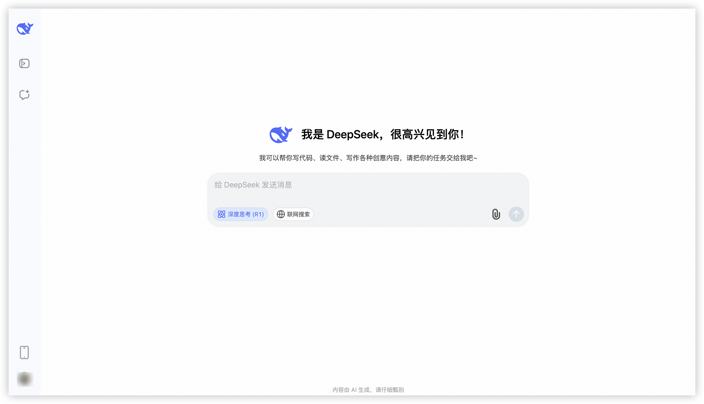

#### 通义千问 Qwen（阿里巴巴，部分开源）

[Qwen](https://help.aliyun.com/en/model-studio/models) 是阿里巴巴的大模型系列，既有开放权重，也有通过阿里云提供的闭源型号。型号覆盖小型本地模型、大型 MoE，以及代码、视觉和音频模型，并支持中文和多种其他语言。

**版本演进**

- **[Qwen1](https://qwenlm.github.io/blog/qwen/)（2023，部分开源）** 以中文、英文能力和开放权重起步，并逐步发布不同参数规模以及视觉、音频等专用模型，形成了千问早期的模型生态。
- **[Qwen2](https://qwenlm.github.io/blog/qwen2/)（2024，部分开源）** 将 GQA 扩展到全部参数规模，并增加多语言、代码、数学和长文本能力。[Qwen2.5](https://qwenlm.github.io/blog/qwen2.5/) 沿用这一架构，重点补强训练数据、结构化输出和指令遵循。
- **[Qwen3](https://qwenlm.github.io/blog/qwen3/)（2025—2026，部分开源）** 同一个模型可以直接回答，也可以先推理再回答。团队先用包含较长推理过程的样本训练模型，再用强化学习提升推理能力。合并两种回答模式后，再用强化学习训练模型处理通用任务。Qwen3-Next 采用 [**Gated DeltaNet（门控 Delta 网络）**](https://arxiv.org/abs/2412.06464)。这些层用固定大小的空间保存前文信息，读到新 token 时更新记录。模型还保留少量标准注意力层，用来查找前文的具体内容。[Qwen3.5](https://qwen.ai/blog?id=qwen3.5) 又在这套架构上加入原生多模态。
- **[Qwen4-Max](https://help.aliyun.com/en/model-studio/qwen4-max)（2026，闭源）** [千问团队](https://qwen.ai/blog?id=qwen4-max)在每三层 Gated DeltaNet 后安排一层千问稀疏注意力（QSA）。Gated DeltaNet 把前文压缩成固定大小的状态，QSA 则从更长的前文中选出相关小块来计算注意力。四条并行的门控残差路径控制层间的信息传递，帮助稳定训练。第二层的 **N-gram Embedding** 根据相邻 token 的组合查表，补充局部词组的信息。Qwen4-Max 和 Qwen3.8-Max 的主干都是 2.4 万亿参数，但每个 token 激活的参数少了约四分之一。Qwen4-Max 也支持图像和视频理解。

**当前型号**

| 型号 | 上下文长度 | 知识截止日期 | 主要用途 |
| --- | ---: | --- | --- |
| Qwen3.6-35B-A3B（开源） | 262K | — | 本地部署、代码和网页 Agent |
| Qwen3.8-Flash（闭源） | 1M | — | 成本敏感的快速调用 |
| Qwen3.7-Plus（闭源） | 1M | — | 通用多模态和生产调用 |
| Qwen4-Max（闭源） | 1M | — | 复杂推理、视觉理解、代码和 Agent 任务 |


型号和快照的上架时间可能随地区不同。

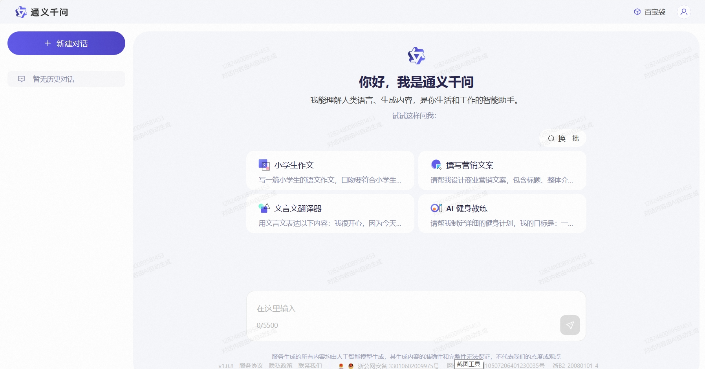


#### Kimi（月之暗面，部分开源）

[Kimi](https://platform.kimi.com/docs/models) 最初因长上下文产品受到关注，用户可以直接上传论文、合同和代码库。后续版本把重点转向代码和 Agent。

**版本演进**

- **[Kimi K2 系列](https://github.com/MoonshotAI/Kimi-K2)（2025—2026，开源）** K2 是万亿参数的混合专家模型。它提出 **MuonClip**：当某个注意力头的分数过高时，调整这一组查询和键的权重，避免分数持续增大导致训练发散。[K2 Thinking](https://www.kimi.com/blog/kimi-k2-thinking) 既能用更多 token 推理，也能多调用几次工具来解决问题。[K2.5](https://www.kimi.com/blog/kimi-k2-5) 加入原生多模态和 **PARL（Parallel-Agent Reinforcement Learning，并行 Agent 强化学习）**，让主 Agent 学会拆分任务，把工作分给多个子 Agent。[K2.6](https://www.kimi.com/blog/kimi-k2-6) 沿用 Agent Swarm。官方公布的上限从 100 个子 Agent、1500 个步骤提高到 300 个子 Agent、4000 个步骤，并报告长时间编码任务的稳定性有所改善。
- **[Kimi K3 系列](https://github.com/MoonshotAI/Kimi-K3)（2026，开源）** K3 扩展到 2.8T 参数，支持原生视觉和百万 token 上下文。它采用月之暗面在 [Kimi Linear](https://arxiv.org/abs/2510.26692) 中提出的 **KDA（Kimi Delta Attention）**。KDA 在 Gated DeltaNet 的基础上，让模型分别决定每个通道保留多少前文信息。K3 也采用 [**AttnRes（Attention Residuals，注意力残差）**](https://arxiv.org/abs/2603.15031)，让模型根据当前输入调整从前面各层读取的信息量。K3 还使用 **Stable LatentMoE**，每个 token 由 896 个专家中的 16 个处理，共激活 104B 参数。按月之暗面技术报告的曲线，在同一份验证数据上达到相同的预测损失，K2 所需的训练计算量约为 K3 的 2.5 倍。这个结果来自模型结构、训练方法和数据处理上的共同改进。[Kimi K3.1 Pro](https://huggingface.co/moonshotai/Kimi-K3.1-Pro) 在 K3 基础上投入更多算力做后训练，重点提升[长时间编码、3D 创作和研究任务](https://www.kimi.com/en/blog/kimi-k3-1-pro)的表现。它把 24 层门控全注意力换成了 DeepSeek 稀疏注意力的门控版本（Gated DSA）。这些层先用索引筛选相关位置，再计算注意力。处理长文档或代码库时，可以减少注意力计算量。

**当前型号**

| 型号 | 上下文长度 | 知识截止日期 | 主要用途 |
| --- | ---: | --- | --- |
| Kimi K2.6（开放权重） | 256K | — | 可切换思考模式的对话、视觉和 Agent 任务 |
| Kimi K3（开放权重） | 1M | — | 长文档、代码库和长时程知识工作 |
| Kimi K3.1 Pro（开放权重） | 1M | — | 长时程编码、3D 创作和研究任务 |

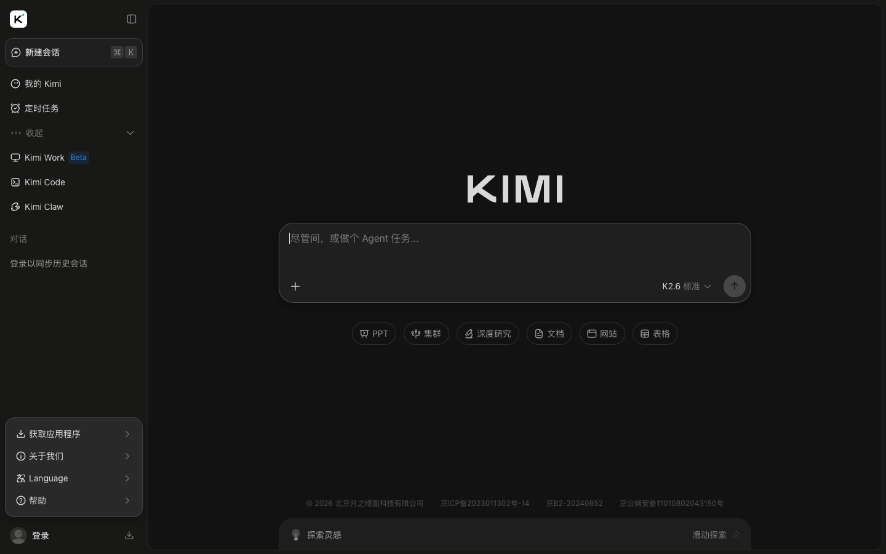

#### GLM / ChatGLM（智谱 AI，部分开源）

[GLM](https://open.bigmodel.cn/) 由智谱 AI 开发，特点是中文能力、开放权重和本地部署支持。当前版本的重点已经转向代码和长时程 Agent。

**版本演进**

- **GLM 与 ChatGLM-6B（2021—2023）** [GLM 论文](https://arxiv.org/abs/2103.10360)提出空白填充式预训练：先遮住文本中的连续片段，再让模型根据前后文逐段补全。2023 年发布的 [ChatGLM-6B](https://github.com/zai-org/ChatGLM-6B) 基于 GLM 架构，有 62 亿参数，量化后可以在消费级显卡上运行。
- **GLM-4 系列（2024—2025，部分开源）** GLM-4 增加工具调用、长上下文和多模态型号，[GLM-4.5](https://github.com/zai-org/GLM-4.5) 随后改用 MoE，并把推理、代码和 Agent 放进同一套后训练流程。[GLM-4.7](https://z.ai/blog/glm-4.7) 加入 **Preserved Thinking（保留思考）** 和 **Turn-level Thinking（轮次级思考）**，分别用于复用多轮推理和逐轮控制是否思考。
- **[GLM-5 系列](https://github.com/zai-org/GLM-5)（2026）** GLM-5 扩大了 MoE 规模，并沿用 DeepSeek 的 DSA 降低长上下文开销。GLM-5.1 改善了长任务中的错误恢复。[GLM-5.2](https://z.ai/blog/glm-5.2) 将上下文扩展到 1M，并提出 **IndexShare**：每四层稀疏注意力共享一个索引器。它还改进了用于推测解码的 MTP 层。GLM-5.3 沿用 5.2 的基座，通过后训练改善编码表现。它共有 744B 参数，每个 token 激活 40B。[GLM-5.3-Flash](https://z.ai/blog/glm-5.3-flash) 共有 320B 参数，每个 token 激活 18B，也是 GLM-5 系列首个原生多模态模型，训练时就纳入了文本和视觉数据。它结合稀疏注意力和线性注意力，减少处理长文本的开销。11 月发布的 [GLM-5.4](https://z.ai/blog/glm-5.4) 是智谱首款采用 **Loop Transformer（循环 Transformer）** 的旗舰模型。它用同一套参数让一组 28 层计算两遍。第二遍沿用第一遍的稀疏注意力索引和筛出的键值缓存，只为滑动窗口内的 token 额外保存缓存。智谱用它编写代码，在 FreeCAD 中建立了一个六轴机械臂模型。

**当前型号**

| 型号 | 上下文长度 | 知识截止日期 | 主要用途 |
| --- | ---: | --- | --- |
| GLM-5.3-Flash（开放权重） | 1M | — | 兼顾效率的编码和长文本任务 |
| GLM-5.3（开放权重） | 1M | — | 复杂编码、调试和长时程 Agent |
| GLM-5.4 | — | — | 编码、调试和视觉理解 |

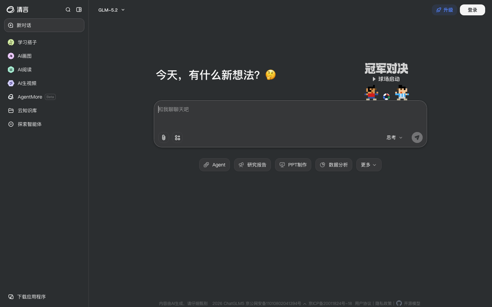

#### 豆包 / Seed（字节跳动，闭源）

豆包是面向用户的应用，[Seed](https://seed.bytedance.com/) 是字节跳动的模型系列，开发者主要通过火山方舟调用。

**版本演进**

- **[Seed 1.6](https://seed.bytedance.com/blog/seed1-6-%E7%B3%BB%E5%88%97%E6%A8%A1%E5%9E%8B%E6%8A%80%E6%9C%AF%E4%BB%8B%E7%BB%8D)（2025）** 提出 **AdaCoT（Adaptive Chain of Thought，自适应思维链）**：训练模型按题目难度决定直接回答还是展开推理，以减少不必要的思考 token。
- **Seed 2 系列（2026）** [Seed 2.0](https://seed.bytedance.com/en/seed2) 相对 Seed 1.8 改进了复杂指令、多模态理解和长时程 Agent。[Seed 2.1](https://seed.bytedance.com/en/blog/seed2-1-officially-released-advancing-ai-productivity) 用强化学习训练模型在界面操作和工具调用之间选择下一步。同一项任务可以跨两种方式完成，例如在设计界面里编辑内容，再调用工具检查结果。

**当前型号**

| 型号 | 上下文长度 | 知识截止日期 | 主要用途 |
| --- | ---: | --- | --- |
| Seed 2.1 Turbo | — | — | 延迟敏感的通用任务和工具调用 |
| Seed 2.1 Pro | — | — | 复杂推理、通用 Agent 和端到端代码任务 |

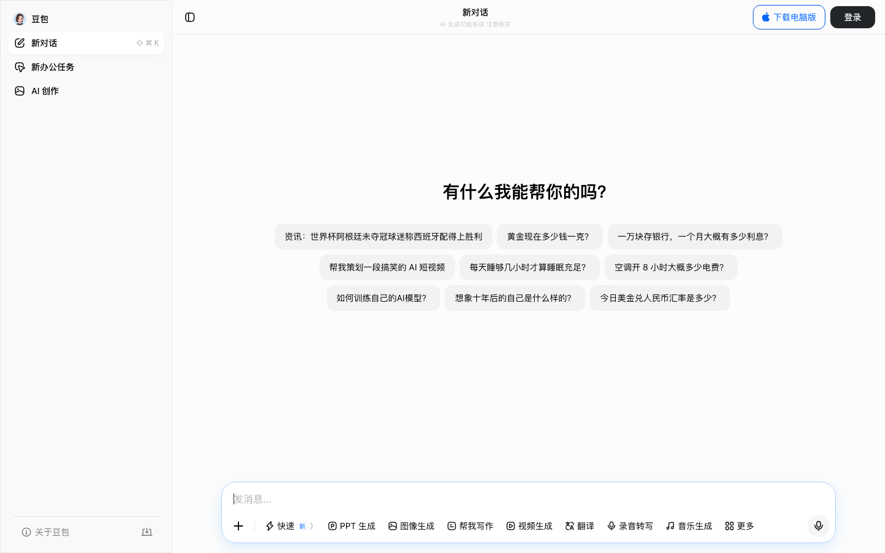

#### 腾讯混元 Hy（腾讯，开放权重）

[腾讯混元 Hy](https://cloud.tencent.com/product/tclm) 系列的 **[Hy4](https://huggingface.co/tencent/Hy4)（2026）** 可以同时处理文本、图片和视频。例如，可以把操作录像和文字说明一起交给模型，让它根据画面解释每一步。Hy4 将图像或视频帧转换成视觉 token，再和文本 token 一起交给语言模型处理。

**[Hy4 flash](https://huggingface.co/tencent/Hy4-flash/blob/main/README_CN.md)（2026）** 接收文字和图片，保留了 1M 上下文。它结合两种注意力：滑动窗口注意力读取附近的 token，IndexPool 稀疏注意力按组筛选较远的前文。模型还用 Engram 根据最近两个或三个 token 的组合查表，把训练时学到的局部模式加入当前表示。腾讯报告，整套设计的键值缓存占用约为 Hy4 的六分之一。[腾讯云](https://cloud.tencent.com/document/product/1823/130079)提供两款模型的 API。

#### MiMo（小米，开放权重）

小米 [MiMo](https://mimo.mi.com/) 系列的 **[MiMo-V2.6 Pro](https://huggingface.co/XiaomiMiMo/MiMo-V2.6-Pro-RL) 和 [Flash](https://mimo.mi.com/docs/zh-CN/news/latest/v2-6)（2026）** 都开放了权重，并支持文本、图像、音频和视频输入。[小米的技术报告](https://arxiv.org/html/2610.11959#S4.SS3)把这一版的重点放在强化学习上。以代码训练为例，模型为同一道题尝试多种改法。评分过程除了检查测试结果，还会在通过测试的方案里区分实现质量，例如是否妥善处理了边界情况。这样，通过测试的方案也能给训练提供不同的反馈。

#### 文心 ERNIE（百度，部分开源）

[文心（ERNIE）](https://ernie.baidu.com/) 是百度的大模型系列，面向用户的产品早期叫文心一言，现在主要通过百度文心网站和文心 APP 提供服务。该系列早期主打知识增强，后来转向多模态。[ERNIE 4.5](https://ernie.baidu.com/blog/zh/posts/ernie4.5/) 提供开放权重，其中的多模态 MoE 为文本和视觉保留部分专用参数，同时共享部分参数。[ERNIE 5.5 Flash Preview](https://ernie.baidu.com/zh/release/ernie-5-5-flash-preview/) 支持 1M 上下文。百度把工作空间纳入训练环境，让模型练习从多个文件里找出相关材料，再按要求制作表格、报告或演示文稿。训练环境既包含只有几十份文件的个人工作空间，也包含上千份文件的企业知识库。

选型时先明确是否需要本地部署、联网、多模态、长上下文或工具调用。做本教程的知识库问答时，可以把同一批问题和检索材料交给几个模型。看看答案是否符合原文、资料不足时模型能否说明缺少什么，再记录每次回答的等待时间和费用。

### 1.1.2 LLM 的特点与能力

LLM 有几项常见特点：

1. **规模大：** 参数量常达数百亿或数千亿，但参数规模并不能单独决定模型能力。
2. **预训练 + 后训练：** 先在大规模数据上预训练，再通过指令微调、偏好优化或强化学习调整行为。
3. **依赖上下文：** 模型会根据前文生成后续内容，因此提示写法和对话历史会直接影响回答。
4. **支持多语言：** 许多模型可以处理英语以外的语言。
5. **支持多模态：** 部分模型还可以处理图像、音频和视频。
6. **存在使用风险：** 模型可能生成有害或带有偏见的内容，也可能泄露输入中的敏感信息。
7. **计算成本高：** 训练和推理通常依赖 GPU 或 TPU。

#### 1.1.2.1 涌现能力（emergent abilities）

模型规模增加后，有些能力会在特定评测中突然出现明显提升，这类现象通常称为**涌现能力**。不过，“突然出现”是否代表模型内部发生了类似物理相变的变化，目前仍有争议。评测指标如果只有“答对或答错”两种结果，原本平滑的能力增长也可能看起来像一次跳变。

上下文学习、指令遵循和逐步推理常与涌现现象一起讨论。除了参数规模，训练方法和提示词写法也会影响这些能力：

1. **上下文学习**：GPT-3 让这种用法受到广泛关注。用户在 Prompt 中给出任务说明或少量示例，模型便可以照着完成新输入，不需要更新模型参数。

2. **指令遵循**：模型能够按照自然语言要求完成任务。指令微调、偏好优化等后训练方法可以改善这项能力。

3. **逐步推理**：对于数学题等多步骤任务，可以在 Prompt 中给出推理示例，引导模型先写出中间步骤再回答，这就是**思维链（CoT，Chain of Thought）**。较新的推理模型还会通过强化学习等方法专门训练这项能力。

#### 1.1.2.2 作为基座模型支持多元应用的能力

2021 年，斯坦福大学的研究人员提出了**基座模型（Foundation Model）**这一概念，指在大规模数据上训练、随后可以适配多种下游任务的模型。大语言模型是其中一种，此外也有面向视觉或多模态任务的基座模型。

开发者可以用提示词、RAG、工具调用或微调，把同一个基座模型用到多个应用中。每项任务无须从头训练模型。是否需要换用专用模型，要看效果、费用、等待时间和数据安全要求。

#### 1.1.2.3 支持对话作为统一入口的能力

Siri、Echo 等产品早已支持用自然语言发出指令。ChatGPT 让更多用户开始通过对话使用大模型，模型可以理解更复杂的指令并生成回答。此后，用户还可以在对话中让 **`智能体（Agent）`** 完成任务：模型会规划步骤、调用工具，并根据结果决定接下来做什么。

LLM 已经用于写作、问答、翻译、搜索和多模态处理。它也让 **AGI（通用人工智能）** 再次成为讨论焦点，但目前没有公认标准可以证明 LLM 是 AGI 的早期形态。

### 1.1.3 Agent 与工具调用

应用可以将历史消息传给模型，让模型延续多轮对话。需要查询实时资料、调用外部 API 或修改文件时，应用可以为模型提供**工具调用（Tool Calling）**。以函数调用为例，开发者告诉模型有哪些函数、各自做什么、需要哪些参数。模型按约定格式给出函数名和参数。应用执行函数，再把结果交给模型。

**Agent 循环**大致是：理解目标 → 选择工具和参数 → 执行工具 → 读取执行结果 → 决定继续操作还是回答用户。实际开发时通常要设置步数上限、超时和成本预算，并记录每一步的输入与输出，方便排查错误。

普通 RAG 可以按固定流程运行：先检索一次资料，再让模型根据资料回答。Agent 也可以把检索当作工具，由模型决定何时搜索、搜索几次。这种做法通常称为 Agentic RAG。

> 下一节介绍 RAG。

【**参考内容**】：

1. [A Survey of Large Language Models](https://arxiv.org/abs/2303.18223)
2. [Are Emergent Abilities of Large Language Models a Mirage?](https://arxiv.org/abs/2304.15004)
3. [周枫：当我们谈论大模型时，应该关注哪些新能力？](https://xueqiu.com/1389978604/248392718)
4. [S 型智能增长曲线：从 Deepseek R1 看 Scaling Law 的未来](https://zhuanlan.zhihu.com/p/22658624635)
5. [一文详尽之 Scaling Law！](https://mp.weixin.qq.com/s?__biz=MzIyNjM2MzQyNg==&mid=2247700024&idx=1&sn=7933ecfaa8d0e127d70d671aff418545&chksm=e9ec360d1ae201b6f875055fe0f83d808076dcadc38144be050297213ff6d8085b241fdb4319&scene=0&xtrack=1)
6. [QwQ: 思忖未知之界](https://qwenlm.github.io/zh/blog/qwq-32b-preview/)
7. [QwQ-32B: 领略强化学习之力](https://qwenlm.github.io/zh/blog/qwq-32b/)

## 1.2 什么是 RAG

LLM 虽然掌握了大量知识，但仍会答错、编造内容，参数中的知识也会逐渐过时。**检索增强生成（RAG，Retrieval-Augmented Generation）** 在生成答案前，先从知识库、搜索引擎或其他外部数据源检索相关材料，再把这些材料作为上下文交给模型。它把模型参数中记住的知识与可更新的外部知识结合起来。

RAG 能否帮助模型答得更准，要看它找到的材料是否相关、是否可靠，以及模型是否按材料作答。应用也可以保留材料的出处，方便读者核对。要是检索到错误材料，模型仍可能给出看似合理的错误答案。

常见问题和 RAG 的对应关系：

- **幻觉：** LLM 可能生成看似合理但并不真实的内容。RAG 用外部材料约束回答，能够减少一部分无依据生成，但不能彻底消除幻觉。
- **知识过时：** 较新的事实可能未进入训练数据。RAG 可以查询更新后的知识库或网页。
- **内容难以追溯：** 直接让模型回答，往往说不清出处。应用可以记录每段检索结果来自哪份文档，再把出处和答案一起显示。开发者需要实现引用功能。
- **垂直知识不够：** 通用模型未必掌握具体行业的细节。RAG 可以检索领域文档，并将相关片段放入上下文。
- **复杂题缺材料：** 参数记忆不够时，检索可以补充事实和背景，但后续推理是否正确仍取决于模型能力与材料质量。
- **业务知识发生变化：** 很多情况下不必重新训练模型，可以更新知识库和索引。业务边界变化较大时，还要重新检查文档分块、检索策略、权限和评测集。
- **长文成本较高：** 将整篇长文放入上下文会增加延迟和费用。RAG 只取相关片段，可以减少输入量；代价是增加索引和检索开销，也可能遗漏分散在不同位置的信息。

### 1.2.1 RAG 的工作流程

工程中的 RAG 通常包含离线建库和在线问答两条流程，可以概括成四步：**数据处理 → 检索 → 增强 → 生成**。数据处理主要离线完成，后面三步在收到用户问题后运行。

<div align=center>
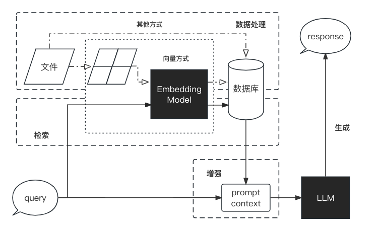
</div>

1. **数据处理阶段**
   1. 对原始数据进行清洗和处理。
   2. 将处理后的数据转化为检索模型可以使用的格式。
   3. 将处理后的数据存储在对应的数据库中。
2. **检索阶段**
   1. 将用户的问题输入到检索系统中，从数据库中检索相关信息。
3. **增强阶段**
   1. 整理检索结果，把相关片段放进提示词，供模型回答时参考。
4. **生成阶段**
   1. 将提示词交给模型，让它参考检索结果生成答案。

### 1.2.2 RAG 与微调

开发 LLM 应用时，RAG 和微调（Fine-tuning）解决的问题不同。

**RAG** 在回答时查找外部资料。**微调**是在特定数据上继续训练，主要用来改变模型的回答方式、文风、格式，或提高它处理某类任务的能力。一个项目可以同时使用两种方法，例如用 RAG 查资料，用微调让模型按业务要求回答。

主要区别见下表（参考 [RAG 综述](https://arxiv.org/abs/2312.10997)、[LoRA](https://arxiv.org/abs/2106.09685) 和 [QLoRA](https://arxiv.org/abs/2305.14314)）：

| 对比维度 | RAG | 微调 |
| -------- | --- | ---- |
| 主要目标 | 在回答时引入外部知识 | 调整模型行为、风格、格式或专项能力 |
| 知识更新 | 更新知识库和索引即可，适合经常变化的内容 | 更新事实通常需要准备数据并重新训练，不适合频繁变化的知识 |
| 外部知识 | 回答时从文档、数据库或网页中检索 | 训练样本会影响模型参数，但不适合充当经常更新的事实库 |
| 数据工程 | 依赖文档解析、分块、元数据、索引和检索评估 | 依赖高质量训练样本、数据清洗和训练集设计 |
| 来源追溯 | 可以把回答关联到检索片段，但需要应用实现引用 | 很难指出某句话来自哪条训练数据 |
| 行为定制 | 仅靠检索不容易稳定改变语气、格式和行为 | 更适合学习固定格式、专业表达和特定任务模式 |
| 系统成本 | 需要维护 Embedding、索引、检索服务和知识更新流程 | 需要训练资源；LoRA、QLoRA 等方法可以降低成本 |
| 在线延迟 | 比直接生成多出一次检索 | 通常不需要额外检索，但速度仍受模型大小和部署方式影响 |
| 降低幻觉 | 正确材料可能减少无依据生成；错误检索也会误导模型 | 专项训练可能改善特定任务，但不能消除幻觉 |
| 隐私风险 | 需要控制文档、索引和检索结果的访问权限 | 训练数据可能被模型记忆或泄漏 |
| 其他风险 | 检索不到、召回错误或不同材料相互冲突 | 过拟合、能力遗忘和事实更新困难 |

### 1.2.3 RAG 示例项目

RAG 已经在多个领域取得了成功，包括问答系统、对话系统、文档摘要、文档生成等。

我们将在第三部分对 RAG 的应用进行详细介绍。将现有成熟的 RAG 案例进行拆解，和大家一起深入了解 RAG。

1. [Datawhale 知识库助手](https://github.com/logan-zou/Chat_with_Datawhale_langchain) 是结合本课程内容、在由[散步](https://github.com/sanbuphy)打造的 [ChatWithDatawhale](https://github.com/sanbuphy/ChatWithDatawhale)—— Datawhale 内容学习助手的基础上，将架构调整为初学者容易学习的 LangChain 架构，并参考第二章内容对不同源大模型 API 进行封装的 LLM 应用，能够帮助用户与 DataWhale 现有仓库和学习内容流畅对话，从而帮助用户快速找到想学习的内容和可以贡献的内容。
2. [天机](https://github.com/SocialAI-tianji/Tianji)是 **SocialAI**（来事儿 AI）制作的一款免费使用、非商业用途的人工智能系统。您可以利用它进行涉及传统人情世故的任务，如如何敬酒、如何说好话、如何会来事儿等，以提升您的情商和核心竞争能力。我们坚信，只有人情世故才是未来 AI 的核心技术，只有会来事儿的 AI 才有机会走向 AGI，让我们携手见证通用人工智能的来临。 —— "天机不可泄漏。"

---

> 对 RAG 有个大致印象后，下一节我们将介绍一个常用的 RAG 开发框架 LangChain。

【**参考内容**】：

1. [Retrieval-Augmented Generation for Knowledge-Intensive NLP Tasks](https://arxiv.org/abs/2005.11401)
2. [Retrieval-Augmented Generation for Large Language Models: A Survey](https://arxiv.org/abs/2312.10997)
3. [面向大语言模型的检索增强生成技术：综述 [译]](https://baoyu.io/translations/ai-paper/2312.10997-retrieval-augmented-generation-for-large-language-models-a-survey)

## 1.3 LangChain

ChatGPT 的巨大成功激发了越来越多的开发者兴趣，他们希望利用 OpenAI 提供的 API 或者私有化模型，来开发基于大型语言模型的应用程序。尽管大型语言模型的调用相对简单，但要创建完整的应用程序，仍然需要大量的定制开发工作，包括 API 集成、互动逻辑、数据存储等等。

为了解决这个问题，从 2022 年开始，许多机构和个人相继推出了多个开源项目，旨在**帮助开发者们快速构建基于大型语言模型的端到端应用程序或工作流程**。其中一个备受关注的项目就是 LangChain 框架。

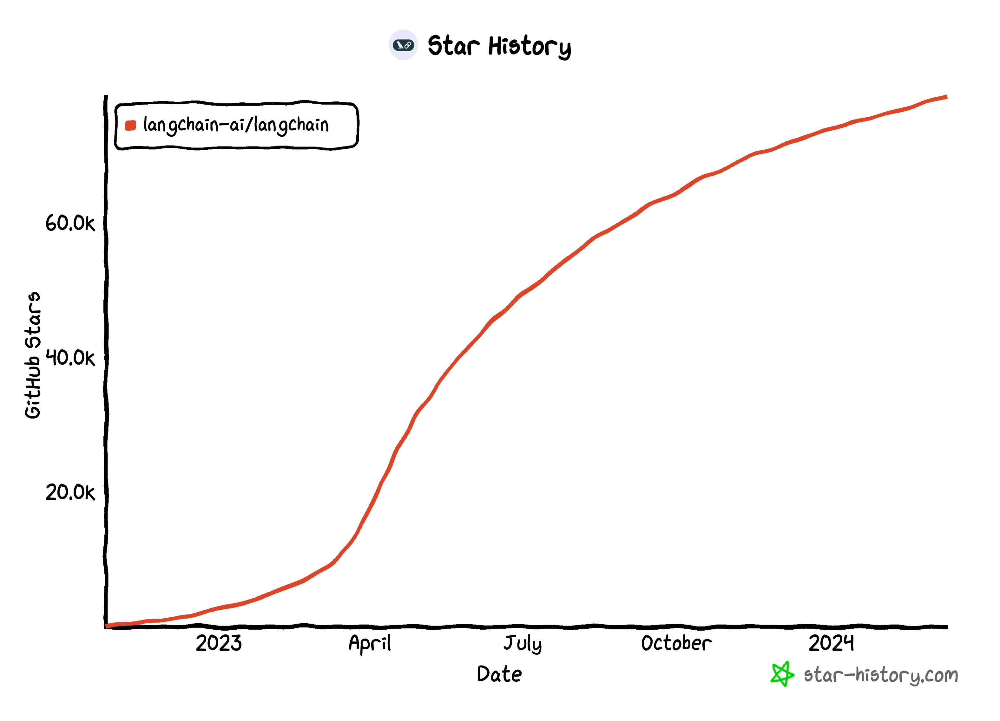

**LangChain 是用来开发大模型应用的开源框架。** 它提供通用接口，方便应用调用不同模型、读取外部资料和连接工具。

利用 LangChain 框架，我们可以轻松地构建如下所示的 RAG 应用（[图片来源](https://github.com/chatchat-space/Langchain-Chatchat/blob/master/img/langchain+chatglm.png)）。在下图中，`每个椭圆形代表了 LangChain 的一个模块`，例如数据收集模块或预处理模块。`每个矩形代表了一个数据状态`，例如原始数据或预处理后的数据。箭头表示数据流的方向，从一个模块流向另一个模块。在每一步中，LangChain 都可以提供对应的解决方案，帮助我们处理各种任务。

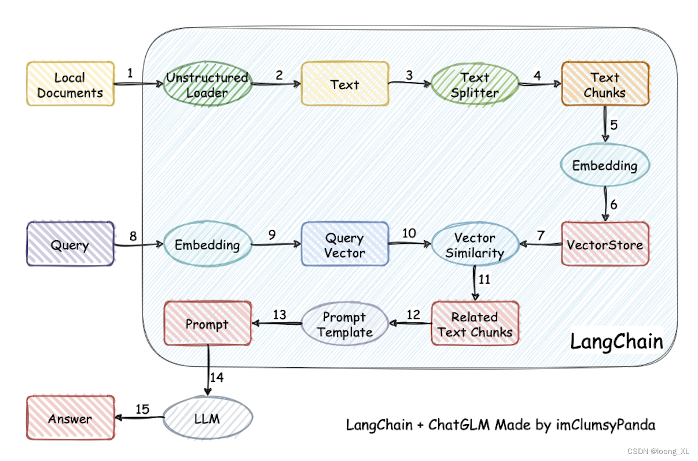

### 1.3.1 LangChain 的核心组件

本课程固定使用 LangChain 0.3.0，后续主要会用到以下模块：

- **模型与 Prompt**：统一不同模型的调用方式，组织输入消息，并解析模型输出。
- **文档与检索**：加载文档、切分文本、生成 Embedding，并连接向量库和 Retriever。
- **链（Chains）与 LCEL**：把 Prompt、模型、Retriever 等组件串成一条流程；后面会用它搭建检索问答链。
- **消息历史与 Memory**：保存对话消息或应用状态，让多轮调用能够延续上下文。
- **工具与智能体（Agents）**：把函数封装成工具，让模型根据任务决定是否调用，并通过 `AgentExecutor` 执行多步循环。
- **回调（Callbacks）**：获取运行过程中的事件，用于流式输出、日志记录和调试。

可以根据应用需要选用这些模块。

### 1.3.2 版本说明：本课程使用 0.3.0

LangChain 更新很快，官网目前以 **LangChain 1.x** 为主。1.x 将 `create_agent` 作为创建 Agent 的标准入口，其底层运行在 LangGraph 上；旧版的 Chains、Retrievers 和索引接口则移入 `langchain-classic`，详见[官方迁移说明](https://docs.langchain.com/oss/python/migrate/langchain-v1)。本仓库的 `requirements.txt` 固定为 **`langchain==0.3.0`**，示例仍按 0.3 的 API 和包结构编写。

| 用途 | 本课程（0.3.0） | LangChain 1.x |
| :-- | :-- | :-- |
| 编排固定流程 | LCEL / Runnable | LCEL / Runnable 仍在 `langchain-core` 中 |
| 创建 Agent | `AgentExecutor` 等旧版接口 | `create_agent`，底层使用 LangGraph |
| 旧版 Chains 和 Retrievers | 位于 `langchain` 包中 | 多数移至 `langchain-classic` |

在运行本教程时，请在 **`llm-universe` 环境**中使用课程固定的 0.3.0，不要直接照搬 1.x 文档中的代码。想试 1.x，可以另建一个 conda 或 venv 环境，并查看 [官方文档](https://docs.langchain.com/oss/python/langchain/overview)。

学习 0.3 时，重点是用 **LCEL** 组织 Chain，以及流式输出、检索链、对话历史和基础工具调用。升级到 1.x 后，这些思路仍可沿用，但部分导入路径和 API 已经改变。

### 1.3.3 LangChain 的生态

- **LangChain Core**：提供消息、Prompt、Runnable、工具等基础接口，以及 LCEL。
- **LangChain Community 与各厂商集成包**：连接模型、文档加载器、向量数据库和其他外部服务。例如，OpenAI 的集成位于 `langchain-openai`。
- **LangGraph**：面向有状态、长时间运行的 Agent，提供更底层的流程控制和持久化能力。LangChain 1.x 的 `create_agent` 就构建在它之上。
- **LangSmith**：用于跟踪运行过程、评测和调试 LLM 应用，也提供 Agent 部署服务。

旧项目中还可能见到 **LangServe** 和 **LangChain CLI**。LangServe 曾用于把 Runnable 发布为 REST API，但[已经停止维护](https://github.com/langchain-ai/langserve)，不建议新项目继续采用。

---

> 本章我们简单介绍了开发框架 LangChain，下一章我们将介绍开发 LLM 应用的整体流程。

## 1.4 大模型开发

我们将开发**以大语言模型为功能核心、通过大语言模型的强大理解能力和生成能力、结合特殊的数据或业务逻辑来提供独特功能的应用**称为**大模型开发**。开发大模型相关应用，其技术核心点虽然在大语言模型上，但一般通过调用 API 或开源模型来实现核心的理解与生成，通过 Prompt Enginnering 来实现大语言模型的控制，因此，虽然大模型是深度学习领域的集大成之作，大模型开发却更多是一个**工程问题**。

在大模型开发中，我们一般不会去大幅度改动模型，而是**将大模型作为一个调用工具，通过 Prompt Engineering、数据工程、业务逻辑分解等手段来充分发挥大模型能力，适配应用任务**，而不会将精力聚焦在优化模型本身上。因此，作为大模型开发的初学者，我们并不需要深研大模型内部原理，而更需要掌握使用大模型的实践技巧。

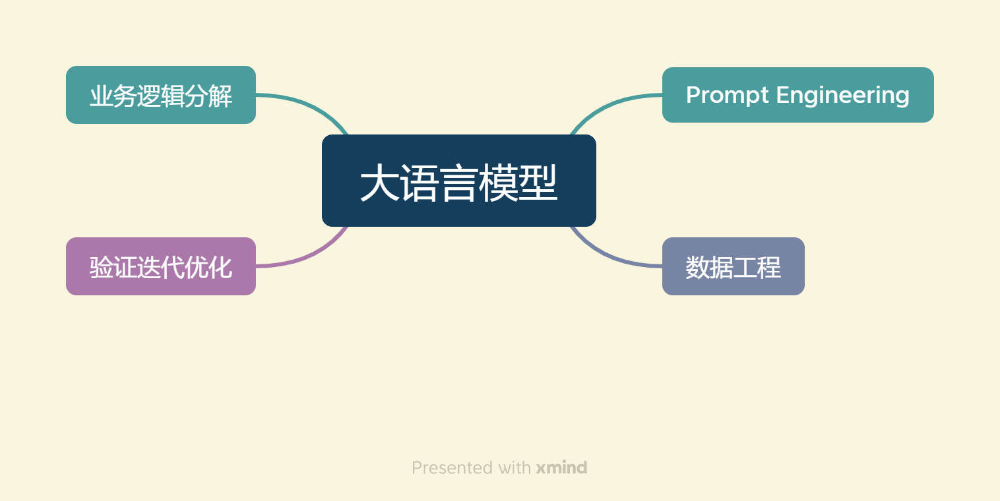

<div align='center'>大模型开发要素</div>

同时，以调用、发挥大模型为核心的大模型开发与传统的 AI 开发在**整体思路**上有着较大的不同。大语言模型的两个核心能力：`指令遵循`与`文本生成`提供了复杂业务逻辑的简单平替方案。

- `传统的 AI 开发`：首先需要将非常复杂的业务逻辑依次拆解，对于每一个子业务构造训练数据与验证数据，对于每一个子业务训练优化模型，最后形成完整的模型链路来解决整个业务逻辑。
- `大模型开发`：用 Prompt Engineering 来替代子模型的训练调优，通过 Prompt 链路组合来实现业务逻辑，用一个通用大模型 + 若干业务 Prompt 来解决任务，从而将传统的模型训练调优转变成了更简单、轻松、低成本的 Prompt 设计调优。

同时，在**评估思路**上，大模型开发与传统 AI 开发也有质的差异。

- `传统 AI 开发`：需要首先构造训练集、测试集、验证集，通过在训练集上训练模型、在测试集上调优模型、在验证集上最终验证模型效果来实现性能的评估。
- `大模型开发`：流程更为灵活和敏捷。从实际业务需求出发构造小批量验证集，设计合理 Prompt 来满足验证集效果。然后，将不断从业务逻辑中收集当下 Prompt 的 Bad Case，并将 Bad Case 加入到验证集中，针对性优化 Prompt，最后实现较好的泛化效果。


<div align = 'center'>传统 AI 评估</div>
<p>


<div align = 'center'>LLM 评估</div>
<p>

在本章中，我们将简述大模型开发的一般流程，并结合项目实际需求，逐步分析完成项目开发的工作和步骤。

### 1.4.1 大模型开发的一般流程

大模型开发大致可以拆成下面几步：

1. **确定目标**。先想清楚应用场景、目标用户和核心价值。个人或小团队宜先定最小目标，从 MVP（最小可行性产品）做起，再迭代。

2. **设计功能**。列出应用要提供的功能，以及每项功能的大致实现方法。业务边界越清楚，Prompt 越容易设计。个人或小团队可以先实现核心功能，再补充上下游流程。例如，个人知识库助手的核心是根据知识库回答问题；上传文档和纠正回答属于配套功能。

3. **搭建整体架构**。按功能把用户输入、模型、外部数据和输出接起来；是否需要数据库、检索或工具，取决于具体任务。本课程使用 LangChain 的 Chain、Tool 等抽象来组织这条链路。

4. **准备数据与索引**。如果应用需要私有知识，再收集和清洗数据。做向量检索时，可以使用 Chroma 这类向量库；常见流程是解析文档、分块、生成向量，并保存文本和元数据。向量数据库按任务需要选用。

5. **Prompt Engineering**。Prompt 用来说明任务、提供上下文并约束输出格式。可以先准备一小批真实业务样例，再编写和调整初版 Prompt。

6. **验证迭代**。用真实业务样例测试边界情况，记录 Bad Case，再据此修改 Prompt、检索或工具链，直到效果基本稳定。

7. **前后端搭建**。核心功能稳定后，再开发页面和接口。本课程不展开前后端技术；个人开发者可以用 Gradio 或 Streamlit 搭建 Demo。

8. **体验优化**。上线后继续收集用户反馈和 Bad Case，据此调整系统。

### 1.4.2 知识库助手示例

下面以本课程的[知识库助手项目](https://github.com/logan-zou/Chat_with_Datawhale_langchain)为例，把前面的通用流程落到一个具体应用中。

#### 1.4.2.1 项目规划与需求分析

**项目目标**：构建一个基于个人知识库的问答助手。

**核心功能**：

- 导入 Markdown、PDF、TXT 等文档，建立知识库索引；
- 根据用户问题检索相关片段，再交给大模型生成回答；
- 支持流式显示、知识库选择和历史对话。

**技术选型**：

- **编排框架**：LangChain 0.3；
- **Embedding 模型**：OpenAI、智谱提供的 Embedding 模型或 [M3E](https://huggingface.co/moka-ai/m3e-base)；
- **向量库**：Chroma；
- **大模型**：通过课程封装的模型接口调用；
- **界面**：Gradio 或 Streamlit。

#### 1.4.2.2 实现流程

项目的数据流如下图所示（参考 [Langchain-Chatchat](https://github.com/chatchat-space/Langchain-Chatchat)）：

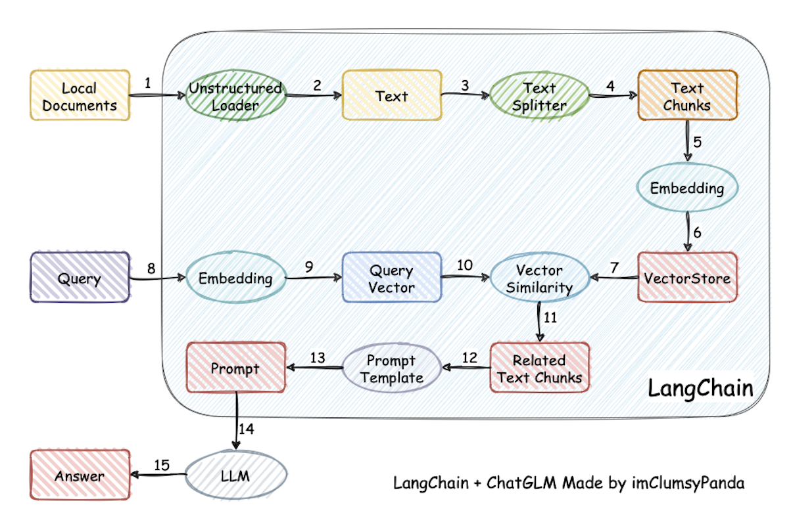

1. **建立知识库**

   读取用户提供的文档，完成解析、清洗和分块。每个文本块生成 Embedding 后写入 Chroma，同时保存来源、标题等元数据。Chroma 既可以只在内存中运行，也可以把数据保存到本地目录；本项目需要重复使用知识库时，应采用持久化存储。

2. **检索并生成回答**

   收到问题后，先生成问题向量，再从 Chroma 中取回最相关的若干文本块。应用把这些片段和问题一起放入 Prompt，交给大模型生成回答。这正是 §1.2 介绍的“检索—增强—生成”流程。

3. **处理对话与界面**

   用流式输出逐步显示回答，把历史消息传给模型来延续对话。界面还需要支持上传文档、选择知识库和查看历史记录。

4. **验证和迭代**

   准备一组有标准答案或参考材料的问题，分别检查检索结果和最终回答。出现 Bad Case 时，要先判断问题出在文档解析、分块、检索、Prompt 还是模型，再修改对应环节。

5. **部署和维护**

   上线前配置 API 密钥、访问权限和日志，测试异常输入与服务中断时的处理。上线后继续更新知识库，并关注回答质量、延迟和调用成本。

---

>
> - 已经配好课程环境的读者，可以跳到第二章《使用 LLM API 开发应用》。
> - 需要远程开发机时，§1.5 介绍阿里云服务器和 SSH，§1.6 介绍 GitHub Codespaces。
> - 已有开发机的同学可以直接阅读 §1.7，配置本课程的 Python 环境。

## 1.5 阿里云服务器的基本使用

没有合适的本地开发环境时，可以用阿里云的云服务器 ECS 运行课程代码。开通前先检查账号是否符合高校计划或免费试用的条件，再查看所选规格和订单费用。

### 1.5.1 高校计划

高校学生通用权益面向所有中国高校学生开放，具体包括中国大陆及港澳台地区专科、本科、硕士、博士、在职研究生等高等教育学籍在内的在校学生人群，在此基础上，阿里云合作高校学生可再享受 3 折专属权益。

申请链接：https://university.aliyun.com/mobile?clubTaskBiz=subTask..11337012..10212..&userCode=1h9ofupt

1.权益一：通过学生认证的中国高校学生，可领取 300 元无门槛优惠券。

2.权益二：通过学生认证的中国高校学生，且所在高校为阿里云合作高校，可在领取 300 元无门槛优惠券的基础上，再领取阿里云公共云产品（特殊商品除外）三折优惠，订单原价不超过 5000 元。

目前合作高校有：清华大学、北京大学、浙江大学、上海交通大学、中国科学技术大学、华南理工大学和香港科技大学（广州）。更多高校洽谈中，敬请期待！


点击图片中的立即领取，用自己实名认证的支付宝扫码登录校验即可。


用户是合作高校的教师（含博士后），且按照活动要求完成身份认证。

目前合作高校有：清华大学、北京大学、浙江大学、上海交通大学、中国科学技术大学、华南理工大学和香港科技大学（广州）。更多高校洽谈中，敬请期待！

- 阿里云全量公共云产品（特殊商品除外）5 折专属优惠，设置专属服务通道，为科研及教学加速。


注：最好在确认优惠券到账的情况下再去购买产品；优惠券信息在`用户中心-卡券管理-优惠券管理`查看。

https://developer.aliyun.com/plan/student

申请链接：https://free.aliyun.com/?crowd=personal
这里推荐大家申请`云服务器 ECS`，每月免费额度 280 元，3 个月有效期。大概配置如下：

- e 系列 2 核 2GB 或者 2 核 4GB（每月 200 元免费额度）；
- 公网流量每月 80 元免费额度（可用于抵扣 100GB 国内地域流量）
  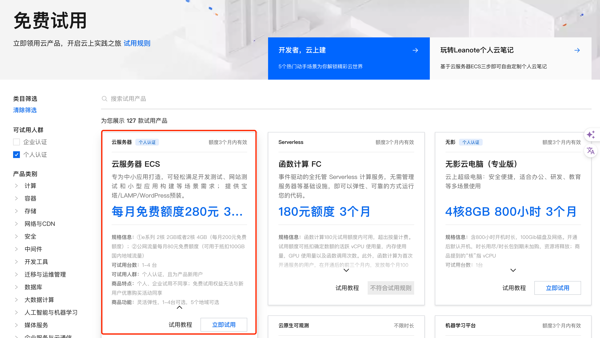

### 1.5.2 创建云服务器指引

以云服务器 ECS 为例，选择满足课程运行需求的规格，镜像选择 Ubuntu。
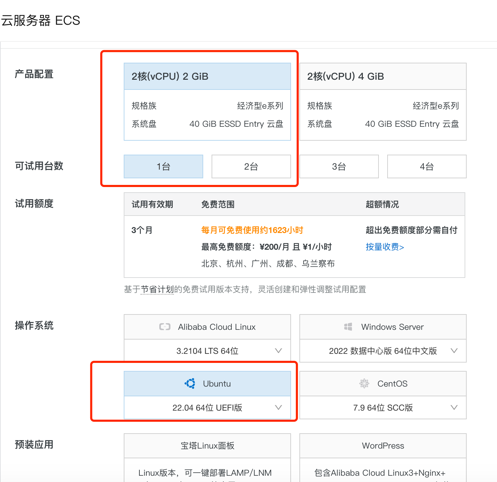
试用时可设置到期自动释放实例。先备份需要保留的文件，再检查云盘、公网 IP 等关联资源的释放设置及费用。


创建完成后点击已试用或者[链接](https://ecs.console.aliyun.com/home#)就可以看到我们刚刚创建的实例。
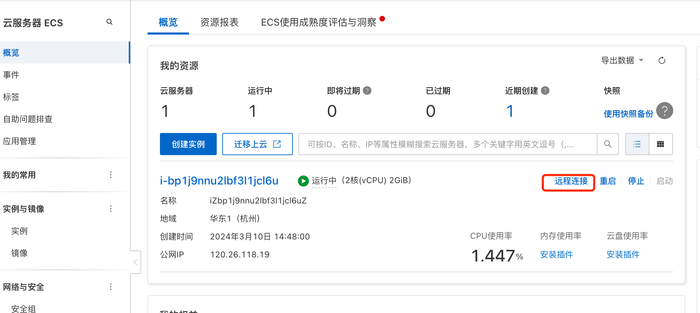
点击远程连接，点击立即登录。
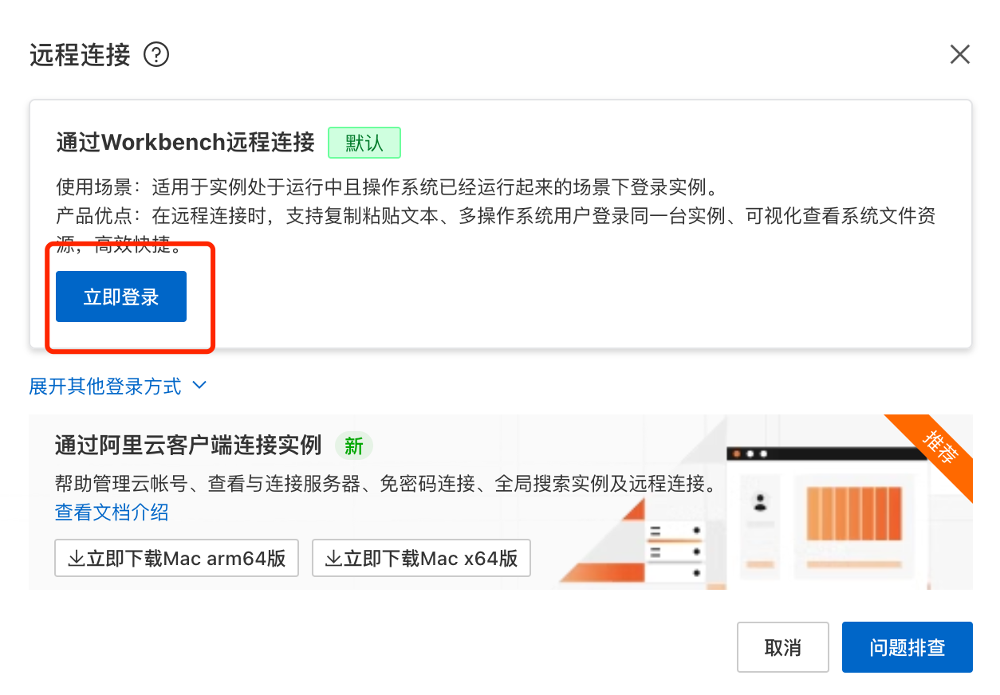
默认密码是 root；
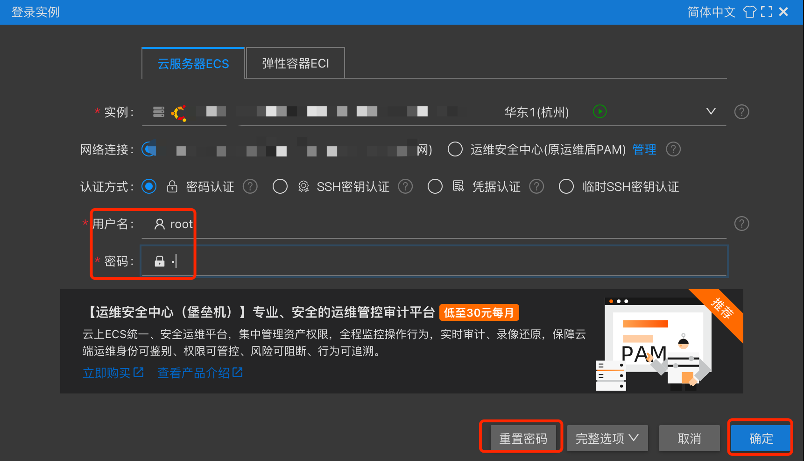
如果不允许登录请按照[链接](https://help.aliyun.com/zh/ecs/user-guide/use-the-password-can-t-login-the-linux-cloud-server-ecs-what-should-i-do)修改服务器配置。  
【简单处理方式：在云服务器管理控制台页面，点击‘远程连接’附近三点，选择重置实例密码。再次登录就可以啦。】
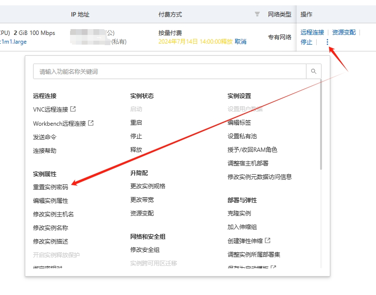

之后就可以进入环境进行学习啦！！！

### 1.5.3 VSCode 连接远程服务器

`Visual Studio Code（VSCode）`是微软提供的免费代码编辑器，支持 Windows、macOS 和 Linux，自带 Git、调试、补全和集成终端，也可以安装扩展。本课程用它连接远程服务器，在本地窗口中编辑远端文件、运行命令。

1. 安装 SSH 插件
   打开 VSCODE 的插件市场，搜索 SSH，找到`Remote - SSH` 插件并安装
   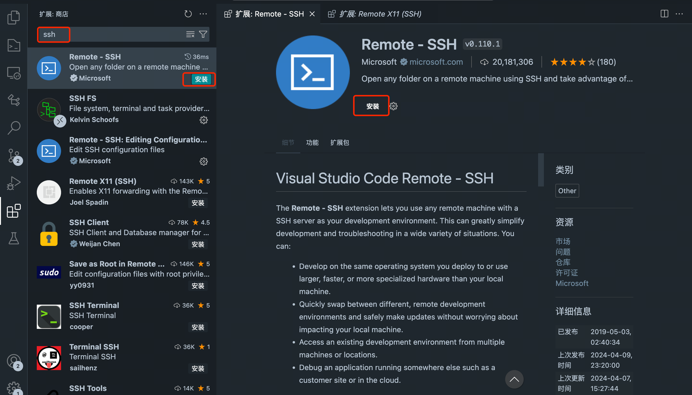

2. 获取服务器 IP
   打开阿里云服务器的[实例列表](https://ecs.console.aliyun.com/server/region/)
   找到我们需要连接的服务器的公网 IP 地址，并复制。
   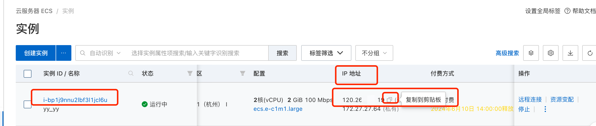
   打开可以连接的远程服务器的编辑器，这里以 VSCODE 为例。
3. 配置 SSH
   打开刚刚下好的`远程资源管理器`插件，添加服务器的 SSH，
   `ssh -p port username@ip`
   port 一般配置为 22,
   username 可以用 root 或者自定义的用户名
   IP 替换成服务器的 IP
   选择本地的 SSH 配置文件
   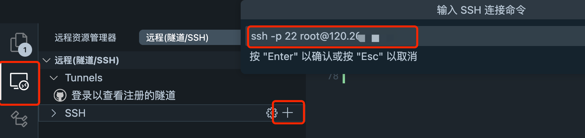
   点击右下角的链接，就可进入服务器
   
4. 连接
   之后我们连接时，可以继续点击左侧的`远程资源管理器`找到我们的服务器，右边有两个选项。

- 箭头是本窗口打开
- 左上角有加号的是新窗口打开
    <p align="center">
        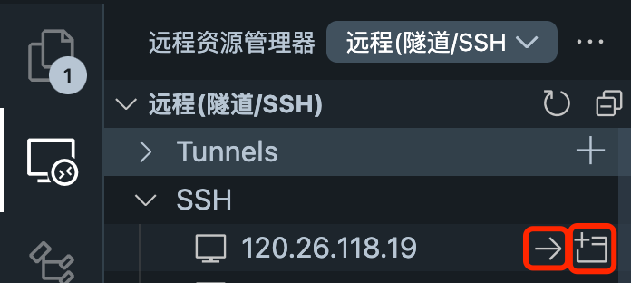
    </p>

5. 打开目录
   之后点击打开文件夹，输入需要的目录即可打开

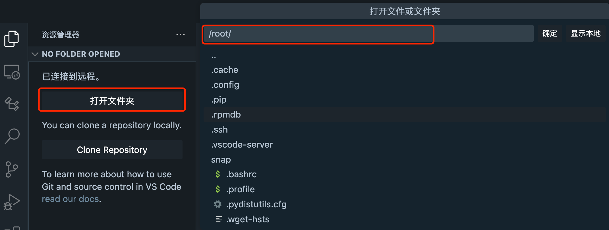

之后就可以进行愉快的编程啦！！！

### 1.5.4 Jupyter Notebook 使用

**Jupyter Notebook** 是一个开源的`交互式计算环境`，它允许用户创建和共享包含实时代码、方程、可视化和文本的文档。它的名字来源于它支持的三种核心编程语言：Julia、Python 和 R，这也是 "Ju-pyt-er" 的名称由来。Jupyter Notebook 编写的文件后缀为 `.ipynb`

Jupyter Notebook 的主要特点包括：

1. **交互式编程**：用户可以在单独的单元格中编写代码并执行，`立即看到代码运行结果`，这对于数据分析、机器学习、科学计算等领域非常有用。

2. **多语言支持**：虽然最初是为 Julia、Python 和 R 设计的，但 Jupyter 现在支持超过 40 种编程语言，通过使用相应的内核。

3. **丰富的展示功能**：Jupyter Notebook 支持 Markdown，允许用户添加格式化文本、图像、视频、HTML、LaTeX 等丰富的媒体内容，使得文档更加生动和信息丰富。

4. **数据可视化**：Jupyter Notebook 与众多数据可视化库（如 Matplotlib、Plotly、Bokeh 等）无缝集成，可以直接在 Notebook 中生成图表和可视化数据。

5. **易于共享**：Notebook 文件可以通过电子邮件、云服务或 Jupyter Notebook Viewer 等方式分享，他人可以查看内容。要重新运行代码，读者需要准备相应的内核、依赖和输入数据。

6. **扩展性**：Jupyter 有大量的扩展插件，可以增强其功能，如交互式小部件、代码自动完成、主题更换等。

7. **科学计算工具集成**：Jupyter Notebook 可以与许多科学计算和数据分析工具集成，如 NumPy、Pandas、SciPy 等 Python 库，使得数据处理和分析变得更加方便。

Jupyter Notebook 是数据科学家、研究人员、教育工作者和学生等广泛使用的工具，它促进了开放科学和教育的发展，使得人们可以更容易地分享和复现研究结果。

本教程使用 Jupyter Notebook 来进行代码编写和运行，方便我们进行代码的编写和调试。

在 `VSCode` 中编辑和运行 `.ipynb`，需要安装微软的 Jupyter 扩展；Python 代码还需要选择可用的 Python 内核。

Notebook 文档由一系列的单元格组成，主要由以下两种形式。

- **代码单元格**：在代码单元格中输入代码并按 `Shift + Enter` 可以运行该单元格中的代码，并在下方显示输出结果。
- **Markdown 单元格**：使用 `Markdown` 语法在单元格中编写文本。可以创建标题、列表、链接、格式化文本等，并使用 `Ctrl + Enter` 来渲染当前 Markdown 单元格。

在代码单元格中写好代码，就可以直接运行并查看结果。下面列出常用快捷键。

**单元格编辑**

- `Enter`: 进入编辑模式。
- `Esc`: 退出编辑模式。

**单元格操作**

- `A`: 在当前单元格上方插入一个新的单元格。
- `B`: 在当前单元格下方插入一个新的单元格。
- `D` (两次按下): 删除当前单元格。
- `Z`: 撤销删除操作。
- `C`: 复制当前单元格。
- `V`: 粘贴之前复制的单元格。
- `X`: 剪切当前单元格。
- `Y`: 将当前单元格转换为代码单元格。
- `M`: 将当前单元格转换为 Markdown 单元格。
- 选中 Markdown 单元格后按 `Enter` 编辑，运行该单元格可以重新渲染。

**代码执行和调试**

- `Shift + Enter`: 运行当前单元格，并跳转到下一个单元格。
- `Ctrl + Enter`: 运行当前单元格，但不跳转到下一个单元格。
- `Alt + Enter`: 运行当前单元格，并在下方插入一个新的单元格。
- `Esc`: 进入命令模式。
- `Enter`: 进入编辑模式。
- `Ctrl + Shift + -`: 分割当前单元格为两个单元格。
- `Ctrl + Shift + P`: 打开命令面板，可以搜索和执行各种命令。

**导航和窗口管理**

- `Up` / `Down` 或 `K` / `J`: 在单元格之间上下移动。
- `Home` / `End`: 跳转到 Notebook 的开始或结束。
- `Ctrl + Home` / `Ctrl + End`: 跳转到当前 Notebook 的第一个或最后一个单元格。
- `Tab`: 在 Notebook 视图中切换到下一个面板（例如，从编辑器到输出或元数据面板）。
- `Shift + Tab`: 在 Notebook 视图中切换到上一个面板。

**其他有用的快捷键**

- 快捷键会随编辑器和自定义设置变化。VS Code 的操作方式见 [Jupyter Notebook 文档](https://code.visualstudio.com/docs/datascience/jupyter-notebooks)。
- `H`: 显示或隐藏 Notebook 的侧边栏。
- `M`: 将当前单元格转换为 Markdown 单元格。
- `Y`: 将当前单元格转换为代码单元格。

---

> 目前我们已经拥有了开发的必备基础，接下来可以直接去`7.环境配置`进行环境配置。

## 1.6 GitHub Codespaces 概述&环境配置（选修）

> **请先确认当前网络能稳定访问 GitHub。连接不稳定时，可以用 §1.5 介绍的阿里云服务器。**

### 1.6.1 创建第一个 codespace

代码空间是托管在云中的开发环境。 可通过将配置文件提交到存储库（通常称为“配置即代码”）来为 GitHub Codespaces 自定义项目，这将为项目的所有用户创建可重复的 codespace 配置。 有关详细信息，请参阅“[开发容器简介](https://docs.github.com/zh/codespaces/setting-up-your-project-for-codespaces/adding-a-dev-container-configuration/introduction-to-dev-containers)”。
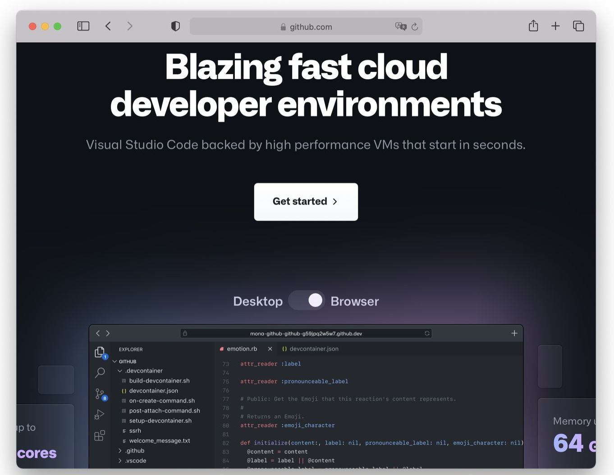

[官方文档](https://docs.github.com/en/codespaces/overview)

1. 打开网址链接：https://github.com/features/codespaces
2. 登录你的 GitHub 账户
3. 点击图示 **Your repositories**
   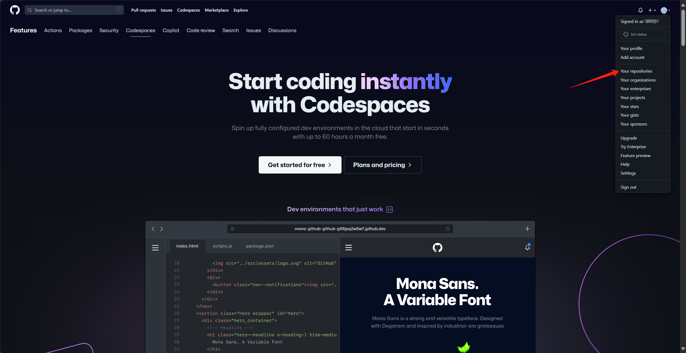
4. 进入自己的存储库列表后，点击图示 **New**，新建一个存储库
   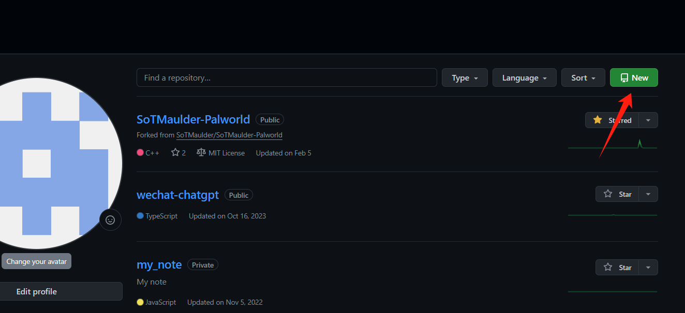
5. 勾选 **Add a README file**，按需要设置仓库可见性，再点击 **Create repository**。课程用到的 API 密钥可保存在 [Codespaces secrets](https://docs.github.com/en/codespaces/managing-your-codespaces/managing-your-account-specific-secrets-for-github-codespaces)，不要写入仓库文件。
   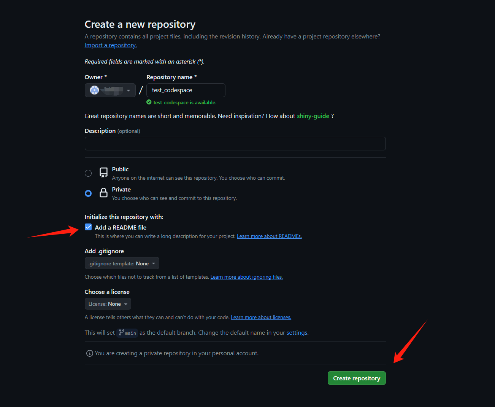
6. 创建好存储库后，点击 **code** 选择 **Codespaces**, 点击图示 **Create codespace on main**
   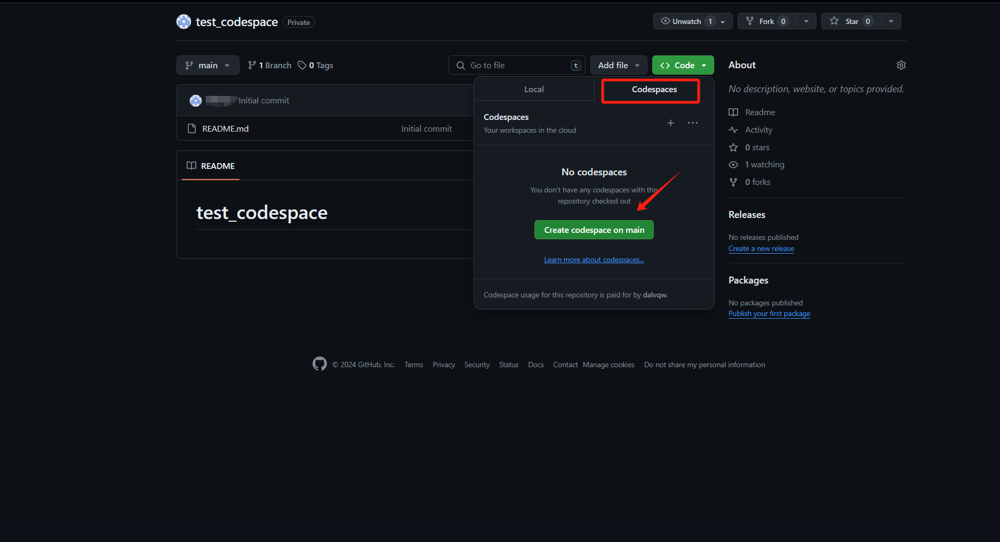
7. 等待一段时间后会出现如下界面，接下来操作与 VSCode 相同，可根据需要安装插件调整设置
   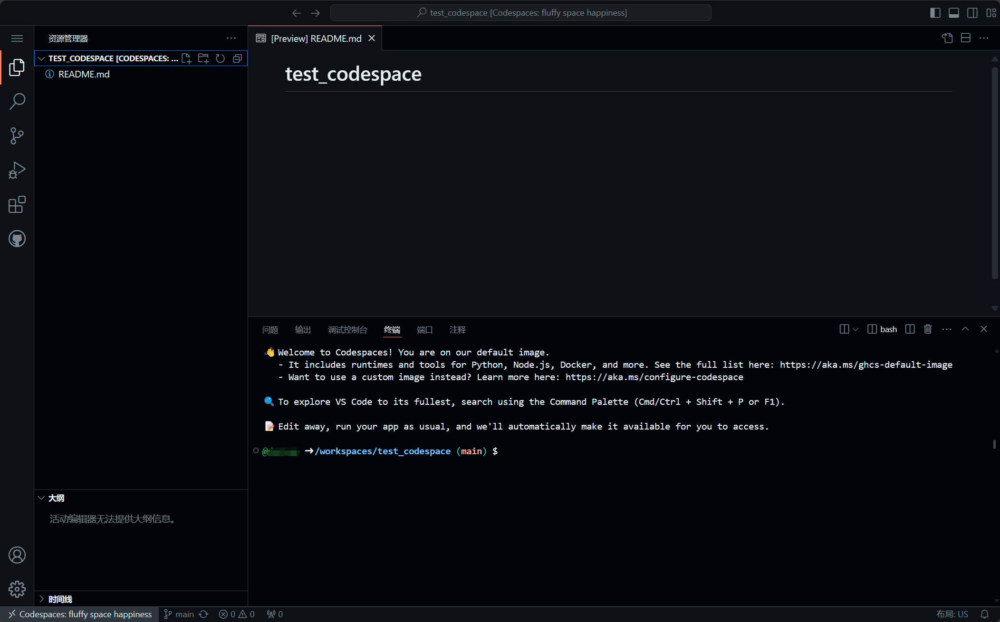

在终端运行 `python --version`。已有 Python 3.10 环境时，可以直接按 §1.7.2 安装课程依赖。环境版本不符时，先创建 Python 3.10 环境。运行 Notebook 前，按 §1.7.3 选择对应内核。

### 1.6.2 本地 VSCode 连接 Codespace（非必需）

1. 打开 VSCode，搜索 codespace 安装插件
   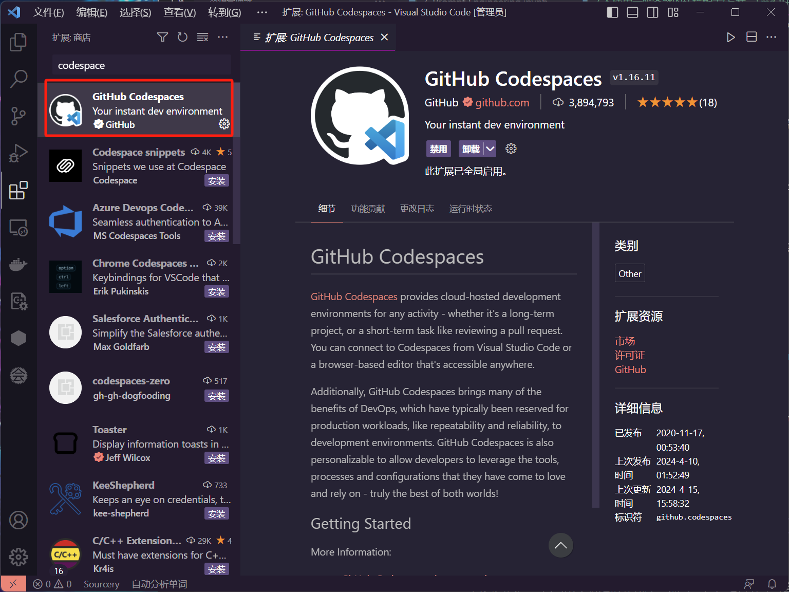
2. 在 VSCode 的活动栏中，单击**远程资源管理器**图标
   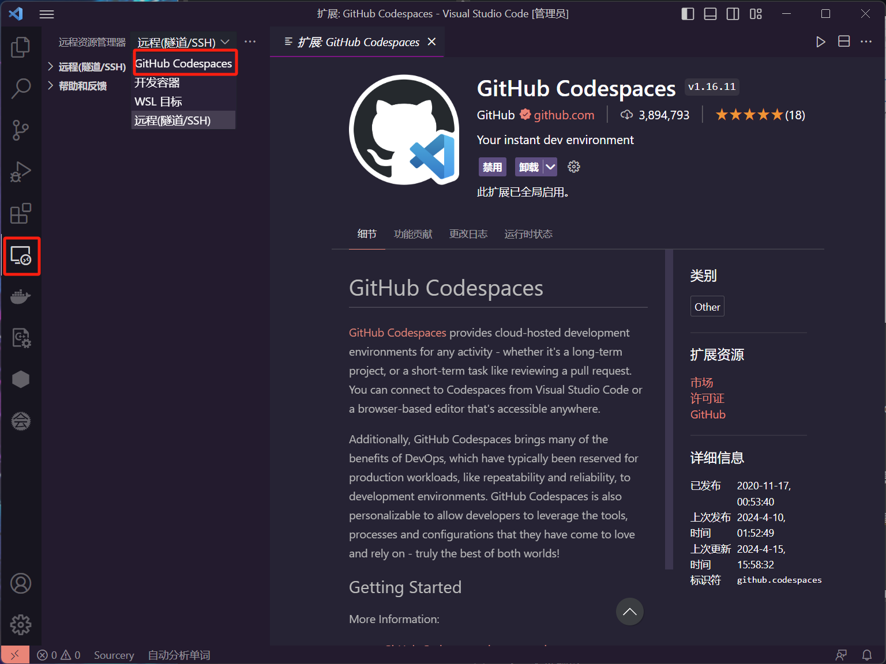
3. 登录 GitHub，根据提示登录即可
   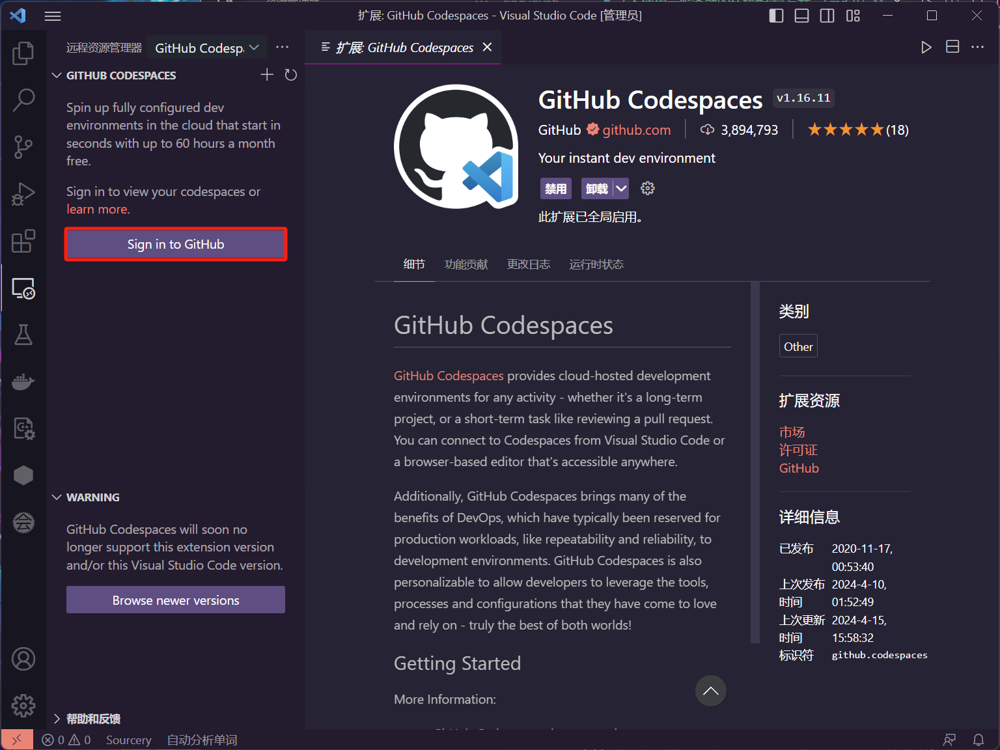
4. 可以看到这里有我们刚才创建的 codespace，单击红框连接图标
   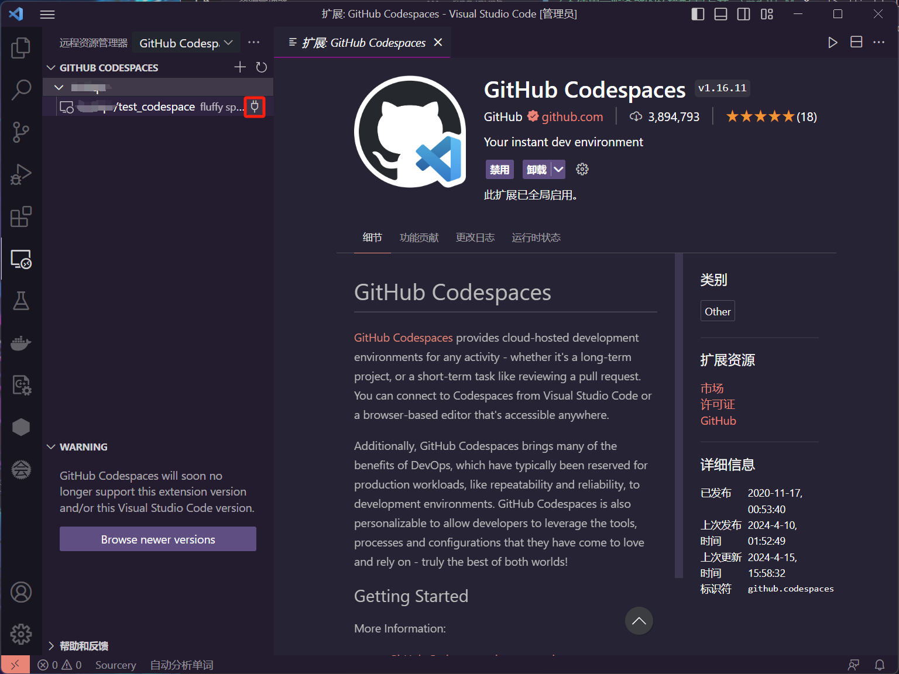
5. 成功连接到了 codespace
   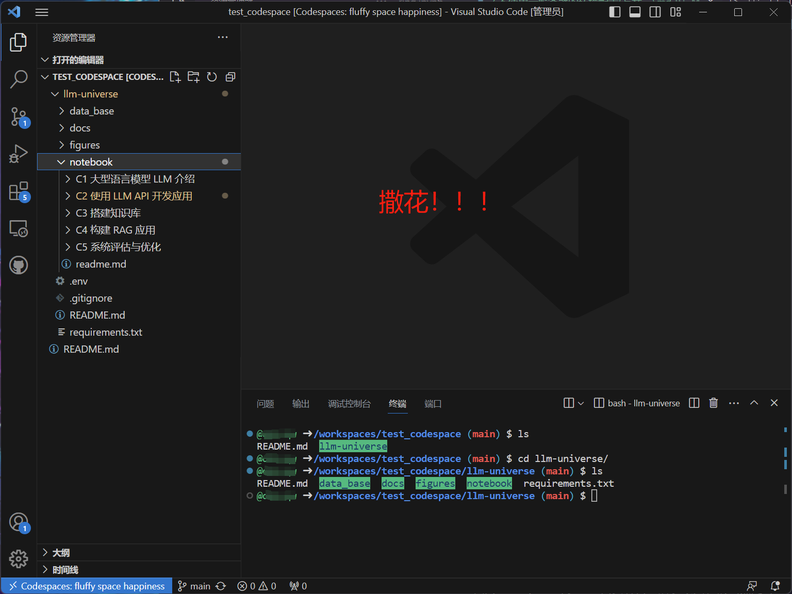
6. [VSCode 官方配置文档](https://docs.github.com/en/codespaces/developing-in-a-codespace/using-github-codespaces-in-visual-studio-code)

> 注意

1. 网页关闭后，找到刚才新建的存储库，点击红框框选内容即可重新进入 codespace
   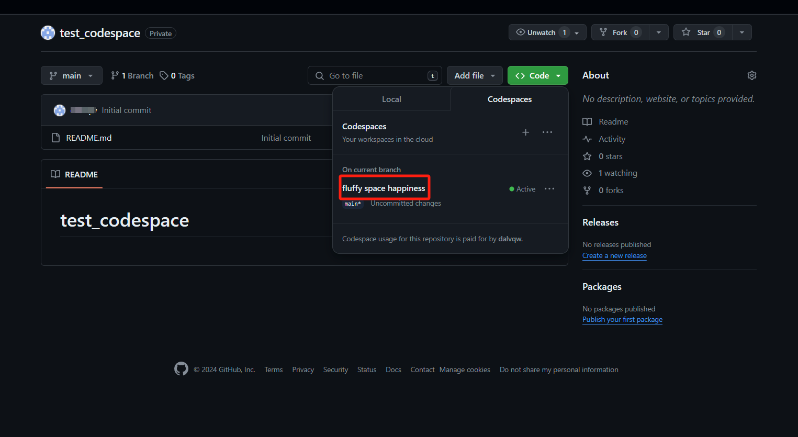
2. 免费额度
   找到 GitHub 的账户设置后，可以在**Plans and usage**中看到剩余的免费额度
   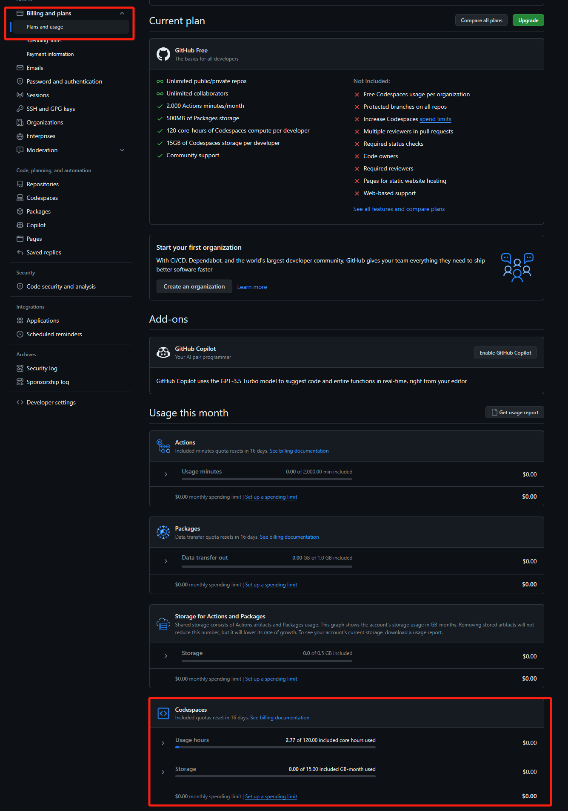
3. codespace 设置，挂起时间建议调整（时间过长会浪费额度）
   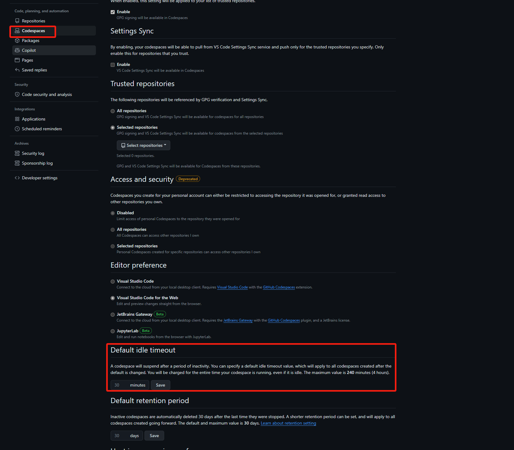
4. 因为 codespace 可以通过网页访问，所以最关键的当然是可以**随身携带平板访问网页进行编程学习**

---

> 目前我们已经拥有了开发的必备基础，下一章我们将对所需要进行环境配置进行详细介绍。

## 1.7 环境配置

本章主要提供一些必要的环境配置指南，包括代码环境配置、VSCODE 代码编辑器的 Python 环境配置，以及一些使用到的其他资源配置。

这里我们详细介绍了代码环境配置的每一步骤，分为基础环境配置和通用环境配置两部分，以满足不同用户和环境的需求。

- **基础环境配置**部分：适用于环境配置**初学者**或**新的服务器环境（如阿里云）**。这部分介绍了如何生成 SSH key 并添加到 GitHub，以及在安装和初始化 conda 环境。

- **通用环境配置**部分：适用于**有一定经验的用户**、**已有环境基础**的本地安装或**完全独立的环境（如 GitHub Codespace）**。这部分介绍了如何新建和激活 conda 虚拟环境，克隆项目仓库，切换到项目目录，以及安装所需的 Python 包。为了加速 Python 包的安装，我们还提供了一些国内镜像源。_对于完全独立的环境，可以跳过前两步关于虚拟环境（conda）配置的步骤_。

### 1.7.1 基础环境配置(配置 git 和 conda)

1. 生成 ssh key
   `ssh-keygen -t rsa -C "youremail@example.com"`
2. 将公钥添加到 github
   `cat ~/.ssh/id_rsa.pub`
   复制输出内容，打开 github，点击右上角头像，选择 `settings` -> `SSH and GPG keys` -> `New SSH key`，将复制的内容粘贴到 key 中，点击 `Add SSH key`。
   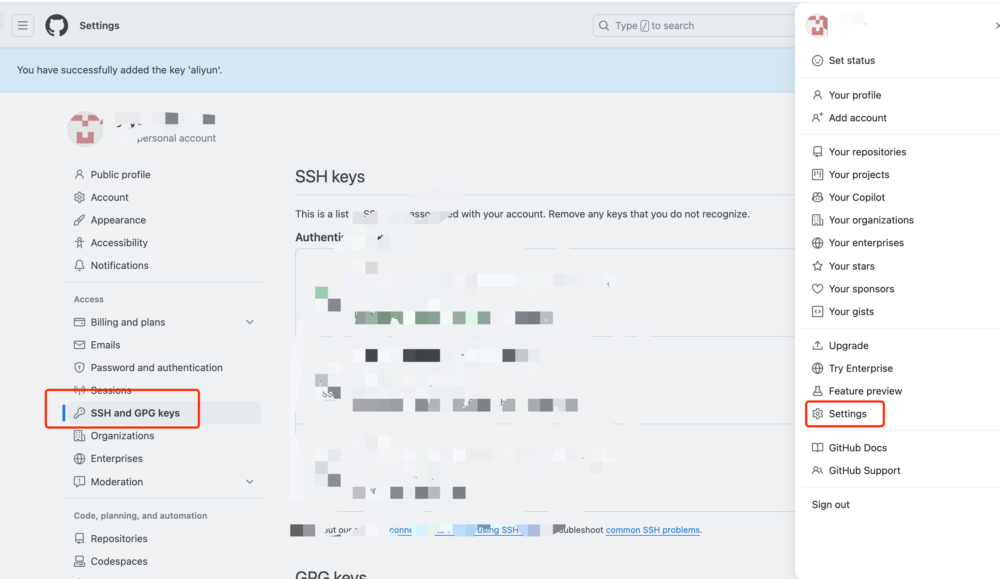

3. 安装 conda 环境

   1. linux 环境（通常采用 linux 环境）

      1. 安装：

         ```shell
         mkdir -p ~/miniconda3
         wget https://repo.anaconda.com/miniconda/Miniconda3-latest-Linux-x86_64.sh -O ~/miniconda3/miniconda.sh
         bash ~/miniconda3/miniconda.sh -b -u -p ~/miniconda3
         rm -rf ~/miniconda3/miniconda.sh
         ```

      2. 初始化：

         ```shell
         ~/miniconda3/bin/conda init bash
         ~/miniconda3/bin/conda init zsh
         ```

      3. 新建终端，检查 conda 是否安装成功 `conda --version`

   2. macOS 环境

      1. 安装

         ```shell
         mkdir -p ~/miniconda3
         curl https://repo.anaconda.com/miniconda/Miniconda3-latest-MacOSX-arm64.sh -o ~/miniconda3/miniconda.sh
         # intel 芯片
         # curl https://repo.anaconda.com/miniconda/Miniconda3-latest-MacOSX-x86_64.sh -o ~/miniconda3/miniconda.sh
         bash ~/miniconda3/miniconda.sh -b -u -p ~/miniconda3
         rm -rf ~/miniconda3/miniconda.sh
         ```

      2. 初始化：

         ```shell
         ~/miniconda3/bin/conda init bash
         ~/miniconda3/bin/conda init zsh
         ```

      3. 新建终端，检查 conda 是否安装成功 `conda --version`

   3. windows 环境
      1. 下载：`curl https://repo.anaconda.com/miniconda/Miniconda3-latest-Windows-x86_64.exe -o miniconda.exe`
      2. 安装：点击下载好的`miniconda.exe`，安装指引进行安装
      3. 打开菜单中的 Anaconda Prompt，检查 conda 是否安装成功`conda --version`
      4. 删除安装包：`del miniconda.exe`
   4. 之后请参照下面的`通用环境配置`部分进行后续配置

### 1.7.2 通用环境配置

1. 新建虚拟环境
   `conda create -n llm-universe python=3.10`
2. 激活虚拟环境
   `conda activate llm-universe`
3. 在希望存储项目的路径下克隆当前仓库
   `git clone git@github.com:datawhalechina/llm-universe.git`
   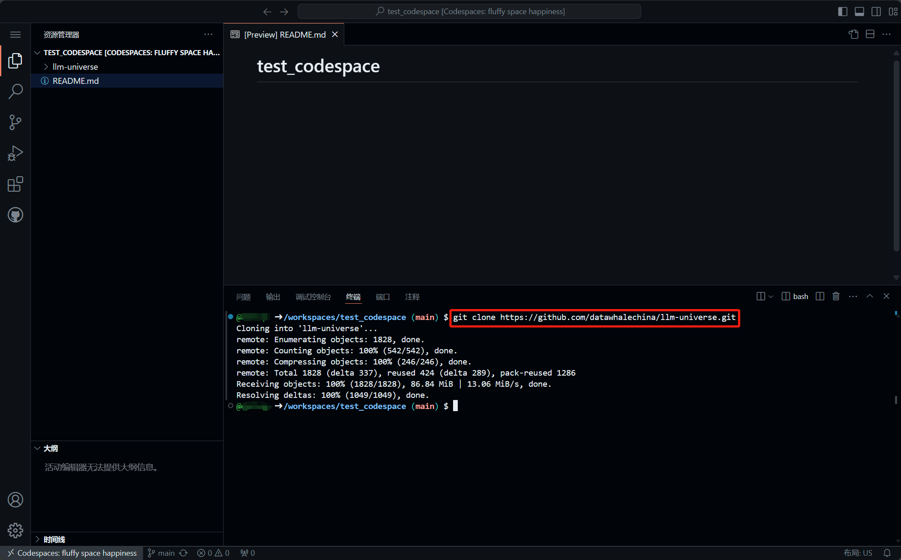
4. 将目录切换到 llm-universe
   `cd llm-universe`
   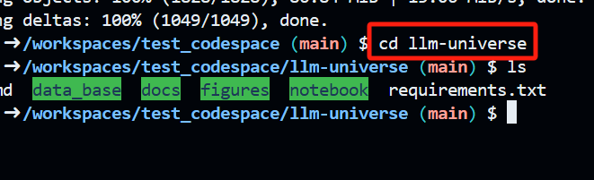
5. 安装所需的包
   `pip install -r requirements.txt`
   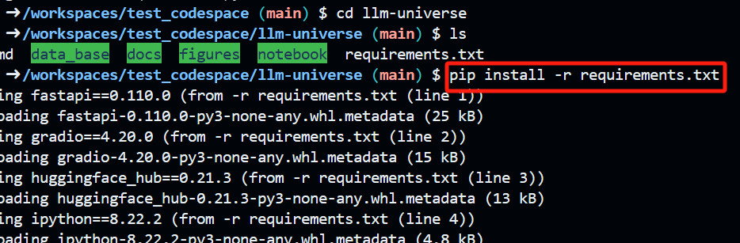
   通常可以通过清华源加速安装
   `pip install -r requirements.txt -i https://pypi.tuna.tsinghua.edu.cn/simple`

> 这里列出了常用的国内镜像源，镜像源不太稳定时，大家可以按需切换：
> 清华：https://pypi.tuna.tsinghua.edu.cn/simple/
> 阿里云：http://mirrors.aliyun.com/pypi/simple/
> 中国科技大学：https://pypi.mirrors.ustc.edu.cn/simple/
> 华中科技大学：http://pypi.hustunique.com/simple/
> 上海交通大学：https://mirror.sjtu.edu.cn/pypi/web/simple/
> 豆瓣：http://pypi.douban.com/simple

### 1.7.3 VSCode 配置 Python 环境

1. 安装 Python 插件

   本教程基于 Python 语言开发， 为了更好的开发体验，我们需要安装 Python 插件。

   在插件市场中搜索`Python`，找到`Python`插件并安装。
   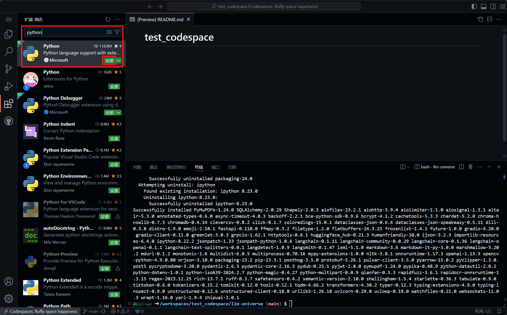
   这时当我们执行 Python 代码时，就会自动识别我们的 Python 环境，并提供代码补全等功能，方便我们进行开发。

2. 安装 Jupyter 插件
   本教程中，我们使用 Jupyter Notebook 进行开发，所以需要安装 Jupyter 插件。
   在插件市场中搜索`Jupyter`，找到`Jupyter`插件并安装。
   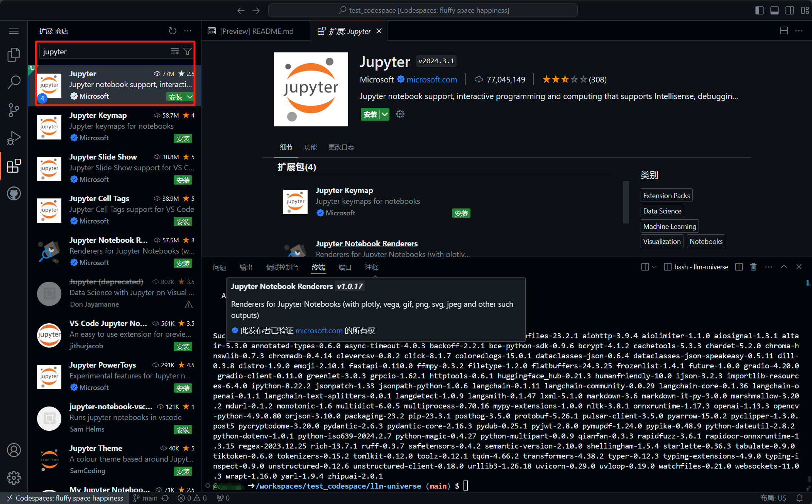

3. 为 Jupyter Notebook 配置 Python 环境

   1. 打开一个 Jupyter Notebook
   2. 点击右上角的内核选择器，选择用于运行当前 Notebook 的 Python 环境。
      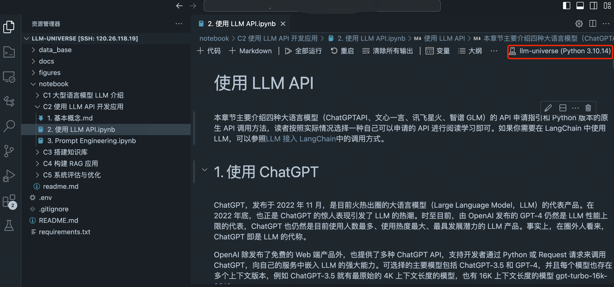
   3. 点击`选择 Python` 后进入环境列表，并选择我们配置好的环境 `llm-universe`。
      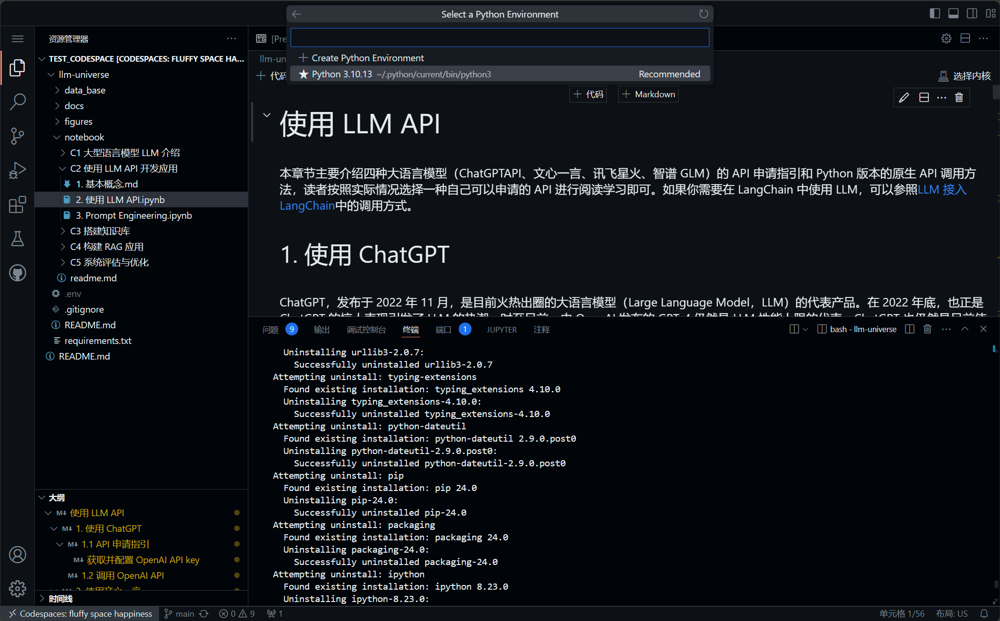

   如果 VS Code 提示缺少内核，请在已激活的 `llm-universe` 环境中执行 `python -m pip install ipykernel`，再选择内核。在代码单元格运行 `import sys; print(sys.executable)`，检查当前内核使用的 Python 路径。

   之后我们就可以在 Jupyter Notebook 中使用我们的 Python 环境进行开发了。
